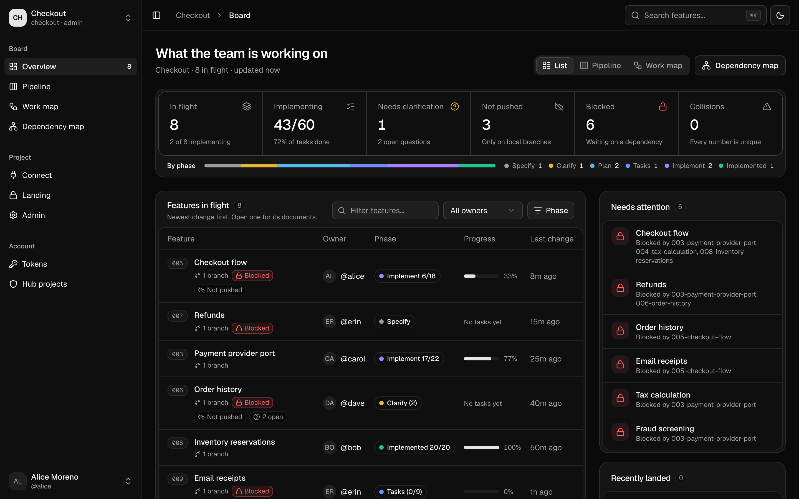
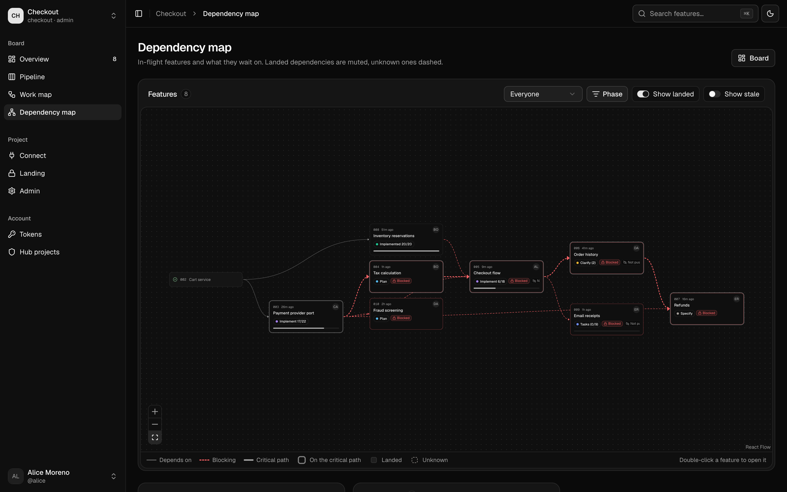
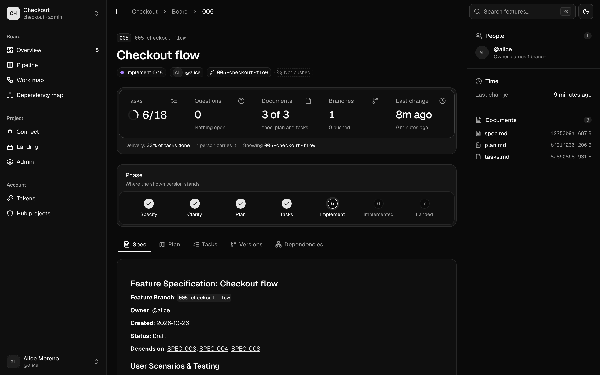
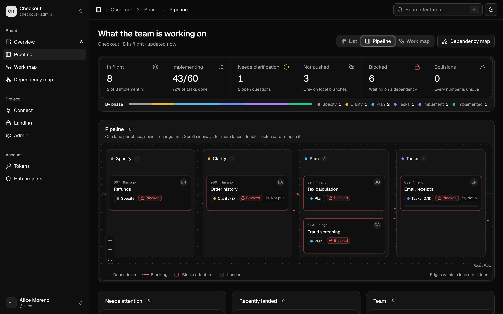
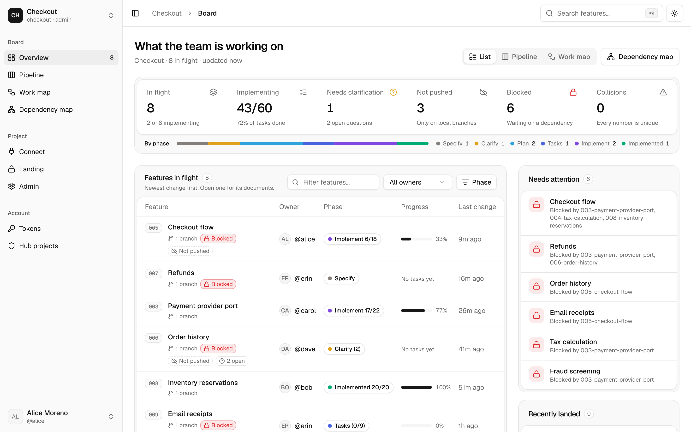
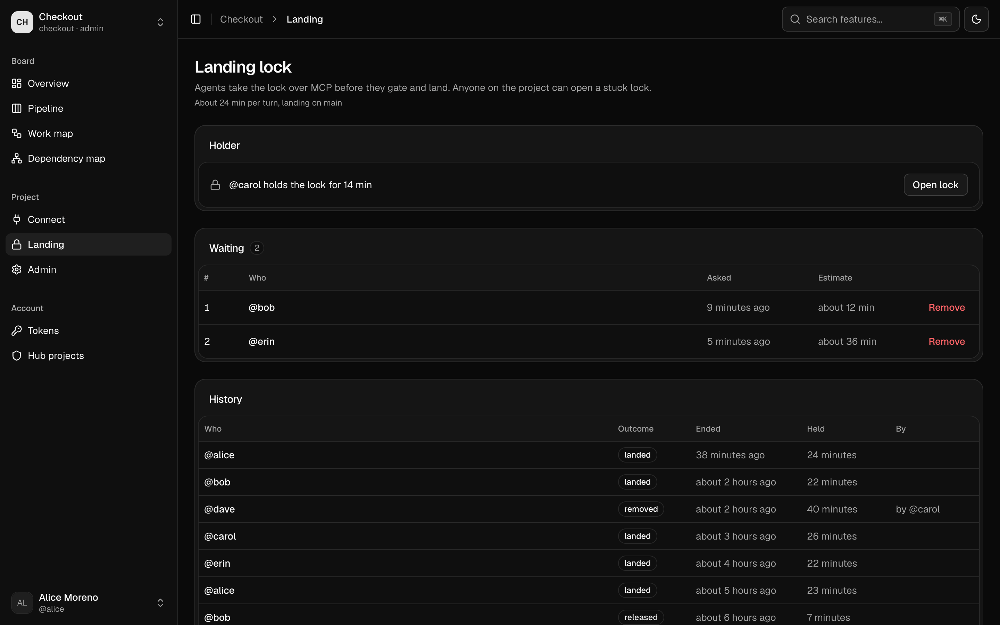

# Spec Hub

A small self-hosted hub for teams that use [GitHub Spec Kit](https://github.com/github/spec-kit).
Everyone's committed spec work shows up in one place, and coding agents can ask the hub what the
rest of the team is doing.

- **Board:** every feature in flight, with its phase, owner, branches and task progress, even when
  it hasn't been pushed yet.
- **Dependency map:** what each feature waits on, what is blocked and the critical path.
- **MCP server:** your agent (Claude Code, VS Code, Cursor and others) reads the board and any
  feature's spec, plan or tasks.
- **Landing lock:** agents take turns landing, so a long pre-land gate is not made stale by someone
  else's land.

The hub never writes to your repository. People sign in with GitHub and see nothing until an admin
adds them to a project.



<details>
<summary>More screenshots</summary>

**Dependency map**, read from each spec's "Depends on" line:



**A feature**, rendered from the developer's own branch before it is pushed:



**Pipeline**, one lane per Spec Kit phase:



**Light mode**:



</details>

The screenshots show a made-up project; its five members reported through the real git hook.

## How it works

```
your clone ──git hook──▶ hub ◀──MCP── your agent
                          │
                          └──▶ dashboard (browser)
```

A Spec Kit extension adds a silent git hook to each clone. After a commit, checkout or merge, it
sends the hub a snapshot of the clone's feature folders (`specs/NNN-name/`). It needs only `sh`,
`git` and `curl`, runs in the background, and never blocks git.

## Run a hub

See **[docs/self-host.md](docs/self-host.md)**. In short:

1. Create a GitHub OAuth App with callback `https://<host>/api/auth/callback/github`.
2. `cp .env.deploy.example .env.deploy` and fill it in.
3. `bin/kamal setup`: deploys to any server you can SSH into, with automatic TLS and its own
   Postgres. Docker Compose behind your own proxy works too.

## Connect a repository

Open the hub's **Connect** page. It has every command filled in for your hub and project:

1. Once per repository: add the extension, link it to the project, and commit:
   ```sh
   specify extension add spec-hub --from https://<hub>/extension/spec-hub.zip
   ```
2. Each developer: create a token on the page and run
   `sh .specify/extensions/spec-hub/scripts/spec-hub connect`.
3. Each developer: add the MCP server to their agent (the page has a tab per client).

More on the reporter and agents: [packages/extension/README.md](packages/extension/README.md).

## Landing lock

For teams that run a long gate (tests, builds, evals) on their own machine before landing to the
default branch. Optional: nothing changes for anyone who doesn't use it.

- `land_lock`: an agent asks for the project's lock before it rebases, gates and lands. If someone
  else holds it, the agent gets a place in a first-come, first-served queue; each call waits up to
  25 seconds, and the agent calls again until it holds the lock.
- `land_unlock`: the holder opens the lock when it has landed or given up, and the next agent in
  the queue gets it.
- `landing`: shows who holds the lock and who is waiting, with estimates.

A lock opens by itself 60 minutes after the holder's last call. Anyone on the project can open it
earlier, or remove someone from the queue, on the **Landing** page; the history records who did.
The lock is advisory: the hub never blocks a push.



## Develop

Needs Node 24, pnpm 12 and Postgres 18.

```sh
cp .env.example .env          # GitHub OAuth App (callback http://localhost:5173/api/auth/callback/github),
                              # BETTER_AUTH_SECRET, SPEC_HUB_ADMINS (numeric GitHub ids)
createdb spechub
pnpm install
pnpm --filter @spec-hub/server db:migrate
pnpm dev                      # http://localhost:5173
pnpm check                    # typecheck, lint, tests, audit
```

| Folder | What |
|---|---|
| `apps/server` | Hono API, MCP endpoint, Better Auth, Postgres (Drizzle) |
| `apps/web` | React dashboard |
| `packages/core` | Pure logic: board, phases, dependency graph, document parsing |
| `packages/extension` | The Spec Kit extension and its `sh` reporter |
| `specs/` | The specs this project is built from |

## Security

- **Sign-in:** GitHub only, identity scopes only. Access is per project, keyed on the numeric GitHub
  account id.
- **Tokens:** personal, stored hashed, and revocable on the Tokens page.
- **Agents:** the MCP tools read the board and change nothing but the landing queue. Text written by team members is passed to agents marked
  as data, not as instructions.
- **Reporting a vulnerability:** open a private security advisory on the repository rather than a
  public issue.

## License

MIT, see [LICENSE](LICENSE).
