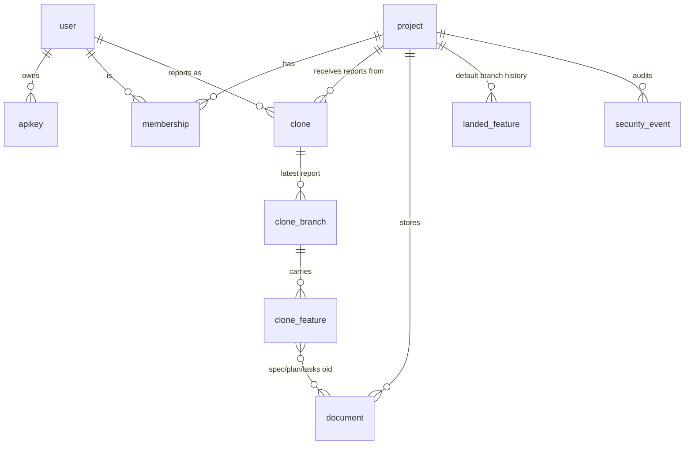
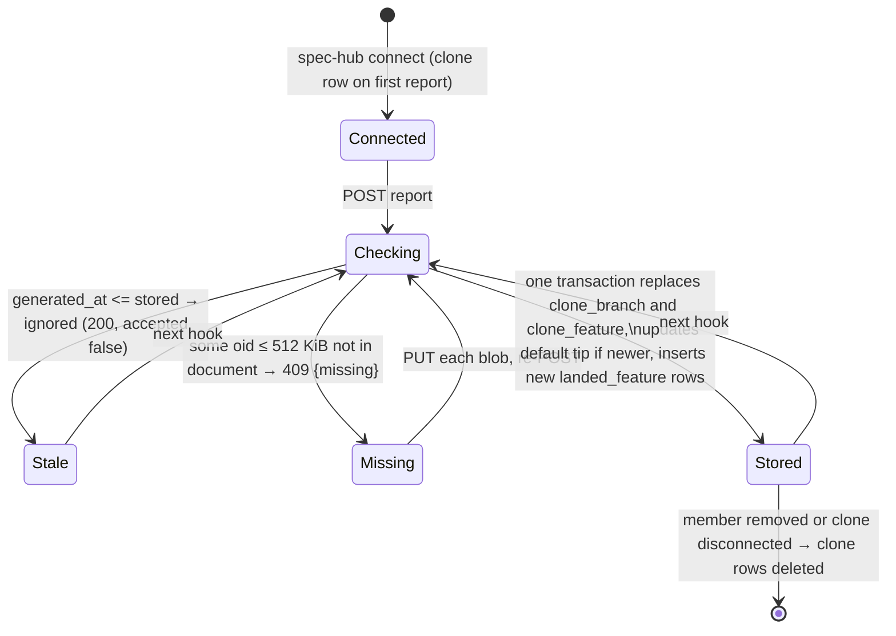

# Data Model: Team board

Postgres, with Drizzle schema in `apps/server/src/db/schema.ts`. Every change ships as a migration
(Art. 6). Columns are snake_case in the database. Times are `timestamptz` unless noted.

## Owned by Better Auth (generated with `pnpm dlx auth@latest generate`)

| Table | Notes |
|---|---|
| `user` | Better Auth columns plus `github_login text not null unique` (lowercase, refreshed at each sign-in; for display and owner headers) and `github_id text not null unique` (the numeric GitHub account id, from the profile at sign-in; what hub admins and access key on). Any GitHub account can sign up. |
| `session` | Browser sessions in the database, so they can be revoked. |
| `account` | `provider_id = 'github'`. `account_id` is the stable numeric GitHub id. |
| `verification` | Used by the OAuth flow. |
| `apikey` | Personal tokens. Stores the hash only. `reference_id` is the user id, `permissions` holds the permissions as JSON text, `last_request` is "last used", and `start` is the first characters, shown in the UI. |

Personal tokens are created with permissions `{ "hub": ["report", "read"] }`. Reporter routes require
`report`; MCP and read routes require `read`.

## Owned by the hub

### `project`

| Column | Type | Rules |
|---|---|---|
| `id` | uuid pk | |
| `slug` | text unique | `^[a-z0-9][a-z0-9-]{1,62}$`. Used in the repo link setting, URLs and the MCP path. |
| `name` | text | 1–100 characters. |
| `default_branch` | text | Default `main`. A valid ref name, at most 255 characters. |
| `numbering` | enum `sequential` \| `timestamp` | Default `sequential`. Controls collision checks (FR-018). |
| `default_tip` | text null | Newest default-branch tip seen in any report. |
| `default_tip_at` | timestamptz null | Commit time of `default_tip`. Only a newer tip replaces it. |
| `created_at` | timestamptz | |

### `membership`

| Column | Type | Rules |
|---|---|---|
| `project_id` | uuid fk → project, cascade | |
| `github_id` | text | The GitHub account id the membership belongs to, resolved from the username by GitHub's API at assign time. |
| `assigned_login` | text | The login GitHub returned at assign time. Shown only while pending; never used to bind or authorize. |
| `user_id` | text null fk → user, set null | The hub user of that account. Set at assign time if it already signed in, else by the user-create hook on its first sign-in (`bindMemberships`, matching `user.github_id`). Null = pending. |
| `role` | enum `admin` \| `member` | |
| `invited_by` | text null fk → user, set null | Who assigned them. |
| `created_at` | timestamptz | |

Primary key `(project_id, github_id)`. A renamed login keeps its memberships; a new GitHub account
that takes an old login (before or after the assignment) gets none (FR-027). Removing a row deletes
that user's clones for the project (FR-030). A person who is not a hub admin (`SPEC_HUB_ADMINS`, GitHub account ids matched
against `user.github_id`) and has no membership row is *waiting for access* (FR-025). Migration
0002 moved the old login-keyed rows over and dropped pending invitations (rows with no user);
0003 re-keyed the rows on `github_id` so pending members exist again, keyed on the account.

### `clone`

| Column | Type | Rules |
|---|---|---|
| `id` | uuid pk | Generated by `spec-hub connect`. Stored in the clone's `git config spec-hub.cloneId`. |
| `project_id` | uuid fk → project, cascade | |
| `user_id` | text fk → user, cascade | A clone id that is already bound to another user is rejected (403). |
| `commit_email` | text | The clone's `git config user.email`, lowercase. Used to map spec authors to members. |
| `generated_at` | bigint | The reporter's clock (ms) for the stored report. Older reports are ignored. |
| `reported_at` | timestamptz | The hub's clock when the report was stored. |
| `created_at` | timestamptz | |

### `clone_branch` — replaced as a whole on every accepted report

| Column | Type | Rules |
|---|---|---|
| `clone_id` | uuid fk → clone, cascade | |
| `name` | text | A ref name, at most 255 characters. |
| `tip` | text | An object id. |
| `tip_at` | timestamptz | |
| `pushed` | boolean | Has an upstream and is not ahead of it. |

Primary key `(clone_id, name)`.

### `clone_feature` — replaced as a whole on every accepted report

| Column | Type | Rules |
|---|---|---|
| `clone_id`, `branch` | fk → clone_branch, cascade | |
| `dir` | text | `^[^/]{1,255}$`, for example `104-ledger-settlement` or `20260319-143022-user-auth`. |
| `last_change_at` | timestamptz | |
| `author_name`, `author_email` | text null | Author of the commit that added `spec.md`. |
| `spec_oid`, `plan_oid`, `tasks_oid` | text null | A null oid means the file doesn't exist on that branch. |
| `spec_size`, `plan_size`, `tasks_size` | integer null | |

Primary key `(clone_id, branch, dir)`.

### `document` — content-addressed, scoped to a project, never replaced

| Column | Type | Rules |
|---|---|---|
| `project_id` | uuid fk → project, cascade | |
| `oid` | text | 40 or 64 lowercase hex characters. Must equal the git blob hash of `bytes` (R6). |
| `size` | integer | At most 512 KiB of content is stored. Larger documents are stored with `content = null` and `too_large = true`, and nothing is uploaded for them. |
| `content` | text null | Null when too large or not valid UTF-8. |
| `too_large`, `unreadable` | boolean | |
| `title` | text null | Parsed facts, computed once at upload by `parseDocument`. |
| `owner_handle` | text null | |
| `open_clarifications` | integer | |
| `tasks_done`, `tasks_total` | integer | |
| `depends_on` | text[] | Directory names linked from the "Depends on" header (FR-036). They are taken from relative links (`../099-x/spec.md`), repository-absolute links (`/specs/099-x/`) and host URLs (`…/specs/099-x/…`). De-duplicated, at most 50. These are content-only facts; self-links are dropped at read time. |
| `created_at` | timestamptz | |

Primary key `(project_id, oid)`. Documents are kept even when no report references them, because
layer 2 approvals cite them. Expected volume is a few MB per project per year; revisit if a project
passes 1 GB.

### `landed_feature`

| Column | Type | Rules |
|---|---|---|
| `project_id` | uuid fk → project, cascade | |
| `dir` | text | |
| `first_seen_at` | timestamptz | When the hub first saw it on the default branch. |
| `baseline` | boolean | True for every directory present in the first default-branch listing the project ever received. These count as history and are never shown as recently landed (FR-017). |

Primary key `(project_id, dir)`. Rows are only ever inserted.

### `security_event` — append-only (FR-031)

| Column | Type | Rules |
|---|---|---|
| `id` | bigserial pk | |
| `at` | timestamptz default now() | |
| `actor_user_id` | text null | Null only for system events. |
| `project_id` | uuid null | |
| `type` | text | One of `sign_in`, `token_created`, `token_revoked`, `member_added`, `member_removed`, `role_changed`, `project_created`, `project_updated`, `clone_connected`. |
| `detail` | jsonb | Never contains a token or document content. |

A migration adds a trigger that raises an error on `UPDATE` or `DELETE`, which makes append-only a
property of the database. No code path issues either statement.

## Relationships

## Report lifecycle (one clone)

## Derived at read time (pure functions in `packages/core`)

None of these is stored; each is computed by `buildBoard`:
- **In-flight entries**: one per `dir`, grouped across the project's clones. The version shown comes
  from the row with the latest `last_change_at`.
- **Phase**: from the shown version's documents and their parsed facts (FR-013).
- **Progress**: `tasks_done` / `tasks_total`.
- **Owner** (FR-015), in order:
  1. the spec's `owner_handle`;
  2. a member whose `user.email` or any of their clones' `commit_email` equals `author_email`;
  3. a GitHub noreply address (`<id>+<login>@users.noreply.github.com`) that matches a member;
  4. otherwise `author_name`.
- **Stale**: `last_change_at` is older than 14 days.
- **Recently landed**: `landed_feature` rows that aren't baseline and are younger than 14 days.
- **Change to a landed feature**: an in-flight `dir` that also has a `landed_feature` row.
- **Number collision** (sequential projects only): the same numeric prefix with a different name,
  either between two in-flight entries or between an in-flight entry and a landed feature.

Computed by `buildDependencyGraph(board)`:
- **Nodes**: every in-flight entry, plus every directory an entry depends on, each with a state:
  in flight (with its phase), landed, or unknown.
- **Edges**: entry → dependency, one per `depends_on` item of the version shown.
- **Blocked**: an entry with at least one dependency that is in flight or unknown.
- **Critical path**: the longest chain of not-yet-landed nodes, after cycles are removed. Ties are
  broken by the oldest last change.
- **Cycles**: strongly connected components with more than one node are marked, and their edges are
  excluded from the critical path computation.

Computed by `buildWorkMap(board, members)`: person → branch → feature nodes from the same versions
(FR-035). Unpushed branches are marked.

The web app imports these functions from `packages/core`, so every view uses exactly the rules of
the list (FR-039).
