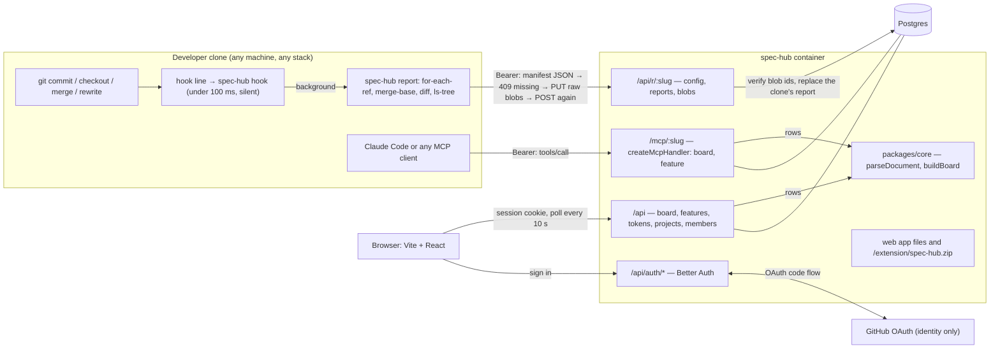
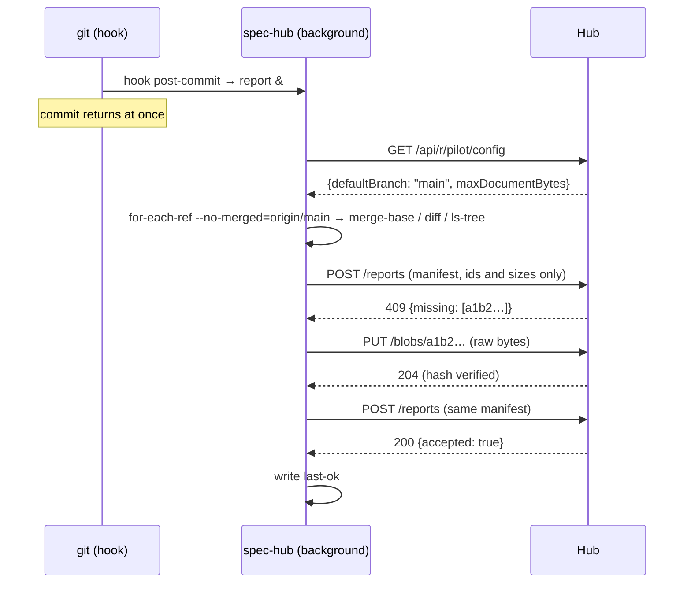
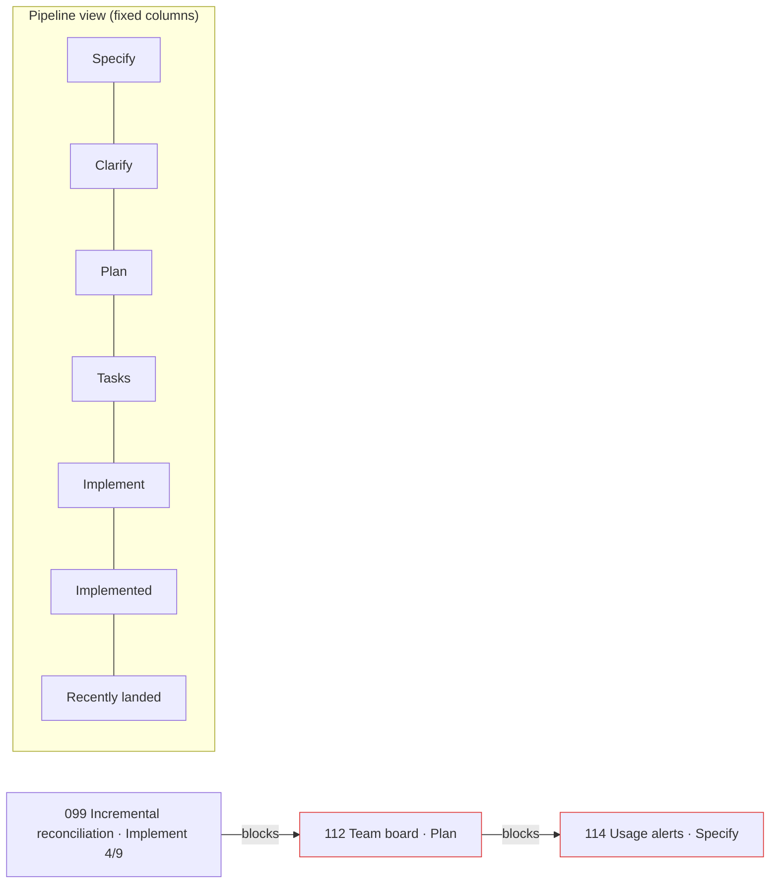

# Pre-Task Review: Team board

Sketches of the four parts most likely to go wrong. These are not the implementation. The design
artifacts are [plan.md](plan.md), [research.md](research.md), [data-model.md](data-model.md) and
[contracts/](contracts/).

## Architecture



Nothing points from the hub to a git host. The only thing that leaves the hub for GitHub is the
OAuth sign-in redirect.

## Critical Path Sketches

### 1. The reporter: silent hook, complete snapshot

The hook line calls `spec-hub hook <event>`. In the foreground, that only shows a pending notice (at
most once a day) and starts a background `report`. The report sends a complete picture of every
non-private local branch that isn't already merged into the default branch. For each such branch, it
covers only the features that branch itself changed (R5), with their documents' content IDs. Only
documents the hub reports missing are uploaded, as raw `git cat-file` output. JSON never carries
document content.

```sh
#!/bin/sh
# spec-hub: Spec Hub reporter. Needs only git and curl. Silent unless asked (Art. 3.6).
set -u
CONFIG=.specify/extensions/spec-hub/spec-hub-config.yml

cfg()       { sed -n "s/^$1:[[:space:]]*//p" "$CONFIG" 2>/dev/null | head -n 1; }
state_dir() { printf '%s/spec-hub' "$(git rev-parse --path-format=absolute --git-common-dir)"; }
json_str()  { printf '"%s"' "$(printf '%s' "$1" | tr -d '\000-\037' | sed 's/\\/\\\\/g; s/"/\\"/g')"; }

cmd_hook() {                                   # foreground: must return in < 100 ms
  git config --local spec-hub.cloneId >/dev/null || exit 0      # not connected: do nothing at all
  s=$(state_dir)
  if [ -f "$s/error" ] && [ "$(cat "$s/error-shown" 2>/dev/null)" != "$(date +%F)" ]; then
    printf 'spec-hub: %s. Run: sh %s status\n' "$(cat "$s/error")" "$0" >&2
    date +%F > "$s/error-shown"
  fi
  ( sh "$0" report --quiet ) </dev/null >/dev/null 2>&1 &
  exit 0
}

# Features this branch changed since it left the default branch that still differ from it (FR-012).
in_flight_dirs() {                             # $1 = base ref (may be empty), $2 = branch
  if mb=$(git merge-base "$1" "$2" 2>/dev/null); then git diff --name-only "$mb" "$2" -- specs/
  else git ls-tree -r --name-only "$2" -- specs/; fi |
  awk -F/ 'NF >= 3 { print $2 }' | sort -u |
  while IFS= read -r dir; do
    git cat-file -e "$2:specs/$dir" 2>/dev/null || continue     # deleted or renamed away on this branch
    [ "$(git rev-parse -q --verify "$2:specs/$dir")" = "$(git rev-parse -q --verify "$1:specs/$dir" 2>/dev/null)" ] ||
      printf '%s\n' "$dir"
  done
}

doc_json() {                                   # $1 = branch, $2 = dir, $3 = file name
  oid=$(git rev-parse -q --verify "$1:specs/$2/$3" 2>/dev/null) || { printf 'null'; return; }
  printf '{"oid":"%s","size":%s}' "$oid" "$(git cat-file -s "$oid")"
}

branches_json() {                              # $1 = base ref
  sep=''
  git for-each-ref ${1:+--no-merged="$1"} refs/heads/ \
      --format='%(refname:short)%09%(objectname)%09%(committerdate:unix)%09%(upstream)%09%(upstream:track)' |
  while IFS="$(printf '\t')" read -r name tip tip_at upstream track; do
    is_private "$name" && continue
    case "$upstream:$track" in :*|*ahead*|*gone*) pushed=false ;; *) pushed=true ;; esac
    printf '%s{"name":%s,"tip":"%s","tipAt":%s,"pushed":%s,"features":[' \
      "$sep" "$(json_str "$name")" "$tip" "$tip_at" "$pushed"; sep=','
    fsep=''
    in_flight_dirs "$1" "$name" | while IFS= read -r dir; do
      author=$(git log --diff-filter=A --format='%an%x09%ae' "$name" -- "specs/$dir/spec.md" | tail -n 1)
      printf '%s{"dir":%s,"lastChangeAt":%s,"author":%s,"docs":{"spec":%s,"plan":%s,"tasks":%s}}' "$fsep" \
        "$(json_str "$dir")" "$(git log -1 --format=%ct "$name" -- "specs/$dir")" "$(author_json "$author")" \
        "$(doc_json "$name" "$dir" spec.md)" "$(doc_json "$name" "$dir" plan.md)" "$(doc_json "$name" "$dir" tasks.md)"
      fsep=','
    done
    printf ']}'
  done
}

post_report() {                                # $1 = manifest file, $2 = "retry" on the second pass
  code=$(curl -s -o "$TMP/resp" -w '%{http_code}' --max-time 15 -H "Authorization: Bearer $TOKEN" \
         -H 'Content-Type: application/json' --data-binary @"$1" "$API/reports") || return 0   # offline: silent
  case "$code" in
    200) date +%s > "$S/last-ok"; rm -f "$S/error" ;;
    409) # The body is {"missing":["<oid>",...]}. Only hex ids and the key word appear, so pick out the ids.
         tr -c '0-9a-f' '\n' < "$TMP/resp" | grep -E '^([0-9a-f]{40}|[0-9a-f]{64})$' |
         while read -r oid; do
           git cat-file blob "$oid" | curl -s -o /dev/null --max-time 15 -X PUT -H "Authorization: Bearer $TOKEN" \
             -H 'Content-Type: application/octet-stream' --data-binary @- "$API/blobs/$oid"
         done
         [ "${2:-}" = retry ] || post_report "$1" retry ;;
    401) record_error 'the hub rejected your token (revoked or invalid)' ;;
    403) record_error "you are not a member of project $(cfg project) on the hub" ;;
    404) record_error "project $(cfg project) does not exist on the hub" ;;
  esac                                         # anything else: silent, the next hook retries
}
```



### 2. Ingestion: verified documents, one transaction, stale reports ignored

The route validates the manifest with the shared zod schema and a body limit. The service then, in
one transaction:
1. locks the clone row;
2. ignores a report that isn't newer than the stored one;
3. returns missing document IDs without changing anything;
4. otherwise replaces the clone's branches and features wholesale, and advances the project's
   default branch only when the reported tip is newer.

Documents are accepted only when the hub's own git hash matches the ID.

```ts
// apps/server/src/routes/reporter.ts
export const reporterRoutes = new Hono<AppEnv>()
  .use('/:slug/*', requireToken('report'), requireMember())
  .get('/:slug/config', (c) =>
    c.json({ defaultBranch: c.var.project.defaultBranch, numbering: c.var.project.numbering,
             maxDocumentBytes: MAX_DOCUMENT_BYTES }))
  .post('/:slug/reports', bodyLimit({ maxSize: MAX_MANIFEST_BYTES }), zValidator('json', ReportManifest),
    async (c) => {
      const r = await ingestReport(c.var.db, { project: c.var.project, userId: c.var.userId,
                                               manifest: c.req.valid('json') })
      switch (r.kind) {
        case 'missing': return c.json({ missing: r.oids }, 409)
        case 'foreign-clone': return c.json({ error: 'this clone id belongs to another person' }, 403)
        case 'stale': return c.json({ accepted: false, reason: 'stale' })
        case 'stored': return c.json({ accepted: true })
      }
    })
  .put('/:slug/blobs/:oid', bodyLimit({ maxSize: MAX_DOCUMENT_BYTES }), async (c) => {
    const oid = Oid.parse(c.req.param('oid'))                      // 422 through the error handler
    const bytes = new Uint8Array(await c.req.arrayBuffer())
    if (gitBlobId(bytes, oid.length === 64 ? 'sha256' : 'sha1') !== oid)
      return c.json({ error: 'content does not match its id' }, 422)
    await storeDocument(c.var.db, c.var.project.id, oid, bytes)    // parseDocument once, insert on conflict do nothing
    return c.body(null, 204)
  })

// packages/core/src/git-object-id.ts
export function gitBlobId(bytes: Uint8Array, format: 'sha1' | 'sha256'): string {
  return createHash(format).update(`blob ${bytes.byteLength}\0`).update(bytes).digest('hex')
}

// apps/server/src/services/ingest.ts
export type IngestResult =
  | { kind: 'stored' } | { kind: 'stale' } | { kind: 'foreign-clone' } | { kind: 'missing'; oids: string[] }

export async function ingestReport(db: Db, { project, userId, manifest }: IngestInput): Promise<IngestResult> {
  return db.transaction(async (tx) => {
    const [clone] = await tx.select().from(cloneT).where(eq(cloneT.id, manifest.cloneId)).for('update')
    if (clone && clone.userId !== userId) return { kind: 'foreign-clone' }
    if (clone && clone.generatedAt >= manifest.generatedAt) return { kind: 'stale' }

    const wanted = uploadableOids(manifest, MAX_DOCUMENT_BYTES)          // de-duplicated, small enough to upload
    const missing = await missingDocuments(tx, project.id, wanted)
    if (missing.length > 0) return { kind: 'missing', oids: missing }
    await storeTooLargeMarkers(tx, project.id, manifest, MAX_DOCUMENT_BYTES)  // size only, too_large = true

    await upsertClone(tx, { id: manifest.cloneId, projectId: project.id, userId,
                            commitEmail: manifest.commitEmail.toLowerCase(), generatedAt: manifest.generatedAt })
    await tx.delete(cloneBranchT).where(eq(cloneBranchT.cloneId, manifest.cloneId))   // cascades to clone_feature
    await insertBranchesAndFeatures(tx, manifest)
    if (manifest.default) await advanceDefaultBranch(tx, project.id, manifest.default)
    return { kind: 'stored' }
  })
}

async function advanceDefaultBranch(tx: Tx, projectId: string, d: DefaultBranchReport) {
  const [p] = await tx.select().from(projectT).where(eq(projectT.id, projectId)).for('update')
  const tipAt = new Date(d.tipAt * 1000)
  if (p.defaultTipAt && p.defaultTipAt >= tipAt) return                 // an older origin/main: ignore
  const baseline = p.defaultTipAt === null                              // first listing ever = history (FR-017)
  await tx.update(projectT).set({ defaultTip: d.tip, defaultTipAt: tipAt }).where(eq(projectT.id, projectId))
  if (d.dirs.length > 0)
    await tx.insert(landedFeatureT)
      .values(d.dirs.map((dir) => ({ projectId, dir, firstSeenAt: new Date(), baseline })))
      .onConflictDoNothing()
}
```

### 3. The board: pure rules in `packages/core`

Each spec rule is a pure function over plain data, so all of it is unit-tested without a database
(Art. 8.1). Documents are parsed once, at upload, into `DocumentFacts`. The parser skips code nodes,
so a clarification marker mentioned in code doesn't count.

```ts
// packages/core/src/parse-document.ts
export interface DocumentFacts {
  title: string | null; ownerHandle: string | null; dependsOn: string[]
  openClarifications: number; tasksDone: number; tasksTotal: number
}
const MARKER = /\[NEEDS CLARIFICATION:/g
const TASK_ID = /^T\d+\b/

// Facts depend on content only, because documents are content-addressed. Every spec sits at
// specs/<dir>/spec.md, so a relative link resolves the same way whatever the directory: it is
// resolved against a placeholder directory, '.'. Links back into the same directory, and self-links
// by name, are dropped at read time by buildDependencyGraph.
export function parseDocument(text: string): DocumentFacts {
  const tree = fromMarkdown(text, { extensions: [gfm()], mdastExtensions: [gfmFromMarkdown()] })
  const facts: DocumentFacts = { title: null, ownerHandle: null, dependsOn: [], openClarifications: 0, tasksDone: 0, tasksTotal: 0 }
  visit(tree, (node) => {
    if (node.type === 'code' || node.type === 'inlineCode') return SKIP
    if (node.type === 'heading' && node.depth === 1 && facts.title === null)
      facts.title = toString(node).replace(/^Feature Specification:\s*/i, '').trim() || null
    if (node.type === 'paragraph' && facts.ownerHandle === null) facts.ownerHandle = ownerHeader(node)  // **Owner**: @x
    if (node.type === 'paragraph' && headerName(node) === 'depends on')                                 // FR-036
      facts.dependsOn.push(...linkedFeatureDirs(node))  // ../099-x/spec.md, /specs/099-x/, …/blob/main/specs/099-x/ → '099-x'
    if (node.type === 'text') facts.openClarifications += node.value.match(MARKER)?.length ?? 0
    if (node.type === 'listItem' && typeof node.checked === 'boolean' && TASK_ID.test(toString(node))) {
      facts.tasksTotal++
      if (node.checked) facts.tasksDone++
    }
  })
  return facts
}

// packages/core/src/phase.ts — FR-013, first match wins
export type Phase =
  | { kind: 'clarify'; open: number } | { kind: 'implement'; done: number; total: number }
  | { kind: 'implemented'; total: number } | { kind: 'tasks'; total: number }
  | { kind: 'plan' } | { kind: 'specify' }

export function inferPhase({ spec, plan, tasks }: VersionDocs): Phase {
  if (spec && spec.openClarifications > 0) return { kind: 'clarify', open: spec.openClarifications }
  if (tasks && tasks.tasksDone > 0)
    return tasks.tasksDone === tasks.tasksTotal
      ? { kind: 'implemented', total: tasks.tasksTotal }
      : { kind: 'implement', done: tasks.tasksDone, total: tasks.tasksTotal }
  if (tasks) return { kind: 'tasks', total: tasks.tasksTotal }
  if (plan) return { kind: 'plan' }
  return { kind: 'specify' }
}

// packages/core/src/board.ts
export interface FeatureVersion {             // one clone_feature row with its documents' facts
  dir: string; branch: string; pushed: boolean; lastChangeAt: Date
  author: { name: string; email: string } | null
  spec: DocumentFacts | null; plan: DocumentFacts | null; tasks: DocumentFacts | null
}
export interface BoardInput {
  versions: FeatureVersion[]; landed: LandedFeature[]; members: MemberIdentity[]
  numbering: 'sequential' | 'timestamp'; now: Date
}
export const WINDOW_MS = 14 * 24 * 60 * 60 * 1000

export function buildBoard({ versions, landed, members, numbering, now }: BoardInput): Board {
  const landedDirs = new Set(landed.map((l) => l.dir))
  const entries: BoardEntry[] = [...groupBy(versions, (v) => v.dir)].map(([dir, vs]) => {
    const shown = maxBy(vs, (v) => v.lastChangeAt.getTime())          // most recently changed version wins
    return {
      dir, number: featureNumber(dir, numbering), title: shown.spec?.title ?? titleFromDir(dir),
      owner: resolveOwner(shown, members), phase: inferPhase(shown),
      branches: vs.map(({ branch, pushed, lastChangeAt }) => ({ branch, pushed, lastChangeAt }))
                  .sort(byRecent),
      lastChangeAt: shown.lastChangeAt, changesLandedFeature: landedDirs.has(dir), collisions: [],
    }
  })
  if (numbering === 'sequential') markCollisions(entries, landed)      // same number, different name
  const isStale = (e: BoardEntry) => now.getTime() - e.lastChangeAt.getTime() > WINDOW_MS
  return {
    inFlight: entries.filter((e) => !isStale(e)).sort(byRecent),
    stale: entries.filter(isStale).sort(byRecent),
    recentlyLanded: landed.filter((l) => !l.baseline && now.getTime() - l.firstSeenAt.getTime() <= WINDOW_MS),
  }
}

// packages/core/src/owner.ts — FR-015
export function resolveOwner(v: FeatureVersion, members: MemberIdentity[]): Owner {
  const header = v.spec?.ownerHandle
  if (header) return members.find((m) => m.githubLogin === header) ?? { kind: 'handle', handle: header }
  const email = v.author?.email.toLowerCase()
  const byEmail = email && members.find((m) => m.emails.includes(email) || m.githubLogin === noreplyLogin(email))
  if (byEmail) return byEmail
  return v.author ? { kind: 'git-name', name: v.author.name } : { kind: 'unknown' }
}
```

### 4. Auth boundary and MCP: verify before anything else

Bearer requests are checked by two Hono middlewares, `requireToken`, then `requireMember`, before
any handler runs. The MCP route passes the resolved caller to `createMcpHandler` as `authInfo`. The
SDK does no verification of its own, which is why the order matters. Browser routes use the Better
Auth session plus `csrf()`. Sign-up is refused unless the GitHub login is invited or is a hub admin.

```ts
// apps/server/src/auth/bearer.ts
export const requireToken = (permission: 'report' | 'read') =>
  createMiddleware<AppEnv>(async (c, next) => {
    const key = c.req.header('authorization')?.match(/^Bearer (\S{8,200})$/)?.[1]
    if (!key) return c.json({ error: 'missing token' }, 401)
    const r = await auth.api.verifyApiKey({ body: { key, permissions: { hub: [permission] } } })
    if (!r.valid || !r.key) return c.json({ error: 'invalid token' }, 401)
    c.set('userId', r.key.referenceId)
    await next()
  })

export const requireMember = (role: 'member' | 'admin' = 'member') =>
  createMiddleware<AppEnv>(async (c, next) => {
    const project = await findProjectBySlug(c.var.db, c.req.param('slug'))
    if (!project) return c.json({ error: 'no such project' }, 404)
    const m = await findMembership(c.var.db, project.id, c.var.userId)  // checked per request: removal is immediate
    if (!m || (role === 'admin' && m.role !== 'admin')) return c.json({ error: 'not a member' }, 403)
    c.set('project', project)
    c.set('membership', m)
    await next()
  })

// apps/server/src/mcp/handler.ts
type Caller = { projectId: string; userId: string }

const mcp = createMcpHandler(({ authInfo }) => {          // the factory runs once per request; the handler is shared
  const { projectId } = authInfo!.extra as Caller
  const server = new McpServer({ name: 'spec-hub', version: HUB_VERSION })
  server.registerTool('board',
    { description: 'What the team is working on: one line per in-flight feature.', annotations: { readOnlyHint: true } },
    async () => text(formatBoard(await loadBoard(db, projectId))))
  server.registerTool('feature',
    { description: 'One feature: phase, progress, owner, branches; or a document\'s full text.',
      annotations: { readOnlyHint: true }, inputSchema: FeatureArgs },
    async ({ id, document }) => featureResult(await loadFeature(db, projectId, id), document))
  return server
})

export const mcpRoutes = new Hono<AppEnv>()
  .all('/:slug', requireToken('read'), requireMember(), (c) =>
    mcp.fetch(c.req.raw, { authInfo: { token: '', clientId: c.var.userId, scopes: ['hub:read'],
                                        extra: { projectId: c.var.project.id, userId: c.var.userId } satisfies Caller } }))

// apps/server/src/auth/auth.ts (excerpt)
export const auth = betterAuth({
  database: drizzleAdapter(db, { provider: 'pg', schema: authSchema }),
  baseURL: env.PUBLIC_URL, secret: env.BETTER_AUTH_SECRET,
  user: { additionalFields: { githubLogin: { type: 'string', required: true, input: false } } },
  socialProviders: { github: { clientId: env.GITHUB_CLIENT_ID, clientSecret: env.GITHUB_CLIENT_SECRET,
    overrideUserInfoOnSignIn: true, mapProfileToUser: (p) => ({ githubLogin: p.login.toLowerCase() }) } },
  plugins: [apiKey({ defaultPrefix: 'sh_', rateLimit: { enabled: false } })],   // the plugin default (10 a day) would cut off the reporter
  databaseHooks: { user: { create: {
    before: async (user) => (await mayJoin(db, String(user.githubLogin), env.SPEC_HUB_ADMINS))
      ? { data: user } : (await audit(db, { type: 'sign_up_blocked', detail: { githubLogin: user.githubLogin } }), false),
    after: async (user) => bindInvitations(db, user.id, String(user.githubLogin)),
  } } },
})
```

### 5. Graphs: one set of rules, four views

Every graph is a pure function in `packages/core` over the board the list view already uses, so
FR-039 (the same features, phases and owners everywhere) holds by construction and is unit-tested.
The web app only lays the graph out and draws it:
- the pipeline uses fixed phase columns;
- the other graphs use dagre;
- nodes are our own read-only types.

The dependency rules are:
- **Blocked**: a feature depends on something that hasn't landed.
- **Cycles**: strongly connected components, found with Tarjan's algorithm.
- **Critical path**: the longest path through the unlanded nodes once cycle edges are removed.

```ts
// packages/core/src/graphs.ts
export type DepNodeState = { kind: 'in-flight'; entry: BoardEntry } | { kind: 'landed'; dir: string } | { kind: 'unknown'; dir: string }
export interface DepGraph {
  nodes: Map<string, DepNodeState>
  edges: { from: string; to: string; inCycle: boolean }[]   // from = dependency, to = dependent
  blocked: Set<string>; criticalPath: string[]; cycles: string[][]
}

export function buildDependencyGraph(board: Board): DepGraph {
  const entries = [...board.inFlight, ...board.stale]
  const landed = new Set(board.landedDirs)                               // every dir ever seen on the default branch
  const nodes = new Map<string, DepNodeState>(entries.map((e) => [e.dir, { kind: 'in-flight', entry: e }]))
  const raw = entries.flatMap((e) =>
    e.dependsOn.filter((d) => d !== e.dir && d !== '.').map((d) => ({ from: d, to: e.dir })))   // FR-036: drop self-links
  for (const { from } of raw)
    if (!nodes.has(from)) nodes.set(from, landed.has(from) ? { kind: 'landed', dir: from } : { kind: 'unknown', dir: from })

  const cycles = stronglyConnected(nodes.keys(), raw).filter((c) => c.length > 1)
  const cycleOf = new Map(cycles.flatMap((c, i) => c.map((d) => [d, i] as const)))
  const edges = raw.map((e) => ({ ...e, inCycle: cycleOf.has(e.from) && cycleOf.get(e.from) === cycleOf.get(e.to) }))

  const unlanded = (d: string) => nodes.get(d)!.kind !== 'landed'
  const blocked = new Set(edges.filter((e) => unlanded(e.from)).map((e) => e.to))
  const criticalPath = longestPath([...nodes.keys()].filter(unlanded), edges.filter((e) => !e.inCycle && unlanded(e.from) && unlanded(e.to)))
  return { nodes, edges, blocked, criticalPath, cycles }
}

// apps/web/src/features/graphs/layout.ts
export function dagreLayout(nodes: Node[], edges: Edge[], size: (n: Node) => { width: number; height: number }): Node[] {
  const g = new dagre.graphlib.Graph().setGraph({ rankdir: 'LR', nodesep: 24, ranksep: 64 }).setDefaultEdgeLabel(() => ({}))
  nodes.forEach((n) => g.setNode(n.id, size(n)))
  edges.forEach((e) => g.setEdge(e.source, e.target))
  dagre.layout(g)
  return nodes.map((n) => { const p = g.node(n.id); const s = size(n); return { ...n, position: { x: p.x - s.width / 2, y: p.y - s.height / 2 } } })
}

export function pipelineLayout(entries: BoardEntry[], recentlyLanded: LandedFeature[]): Node[] {
  const column = (phase: Phase['kind']) => PHASE_ORDER.indexOf(phase)          // specify … implemented; landed is last
  const rowInColumn = new Map<number, number>()
  const place = (col: number) => { const row = rowInColumn.get(col) ?? 0; rowInColumn.set(col, row + 1); return { x: col * (CARD_W + GAP), y: HEADER_H + row * (CARD_H + GAP) } }
  return [
    ...PHASE_ORDER.map((p, i) => ({ id: `col:${p}`, type: 'column', position: { x: i * (CARD_W + GAP), y: 0 }, data: { phase: p }, selectable: false })),
    ...entries.map((e) => ({ id: e.dir, type: 'feature', position: place(column(e.phase.kind)), data: { entry: e } })),
    ...recentlyLanded.map((l) => ({ id: l.dir, type: 'landed', position: place(PHASE_ORDER.length - 1), data: { landed: l } })),
  ]
}

// apps/web/src/features/graphs/graph-canvas.tsx
const nodeTypes = { feature: FeatureNode, landed: LandedNode, unknown: UnknownNode, column: ColumnNode, person: PersonNode, branch: BranchNode }

export function GraphCanvas({ nodes, edges, onSelect }: { nodes: Node[]; edges: Edge[]; onSelect: (id: string) => void }) {
  return (
    <ReactFlow nodes={nodes} edges={edges} nodeTypes={nodeTypes} fitView minZoom={0.2}
      nodesDraggable={false} nodesConnectable={false} elementsSelectable
      onNodeClick={(_, n) => onSelect(n.id)} proOptions={{ hideAttribution: false }}>
      <Background variant={BackgroundVariant.Dots} gap={16} />
      <Controls showInteractive={false} />
    </ReactFlow>
  )
}

function FeatureNode({ data }: NodeProps<Node<{ entry: BoardEntry; blocked: boolean }>>) {
  const { entry, blocked } = data                     // every string below is React text, never HTML (Art. 5.5)
  return (
    <div role="button" tabIndex={0} aria-label={featureAriaLabel(entry, blocked)}>
      <Handle type="target" position={Position.Left} />
      <FeatureCard entry={entry} blocked={blocked} size="compact" />
      <Handle type="source" position={Position.Right} />
    </div>
  )
}
```



## Assumptions

Decisions made on 2026-10-26 (the user answered "yes" to the plan review and chose options on the
kit and on dependencies):
- **Sign-in only for invited people. No token expiry.** Both are recorded in the spec's
  Assumptions.
- **Collision check also against landed features.** Recorded in the spec's Assumptions.
- **Constitution 1.1.0 applied**: static files are public, client scripts are POSIX `sh`, graphs use
  xyflow and dagre, and licensed templates are design references only.
- **The admin kit is a design reference only**, because of its license. Every component is ours, on
  MIT shadcn/ui. ui.md has the mapping.
- **Dependency map in 001** (User Story 6, FR-035 to FR-039).

These are things I still inferred rather than read in the spec. Please confirm or correct them.
- **Dependencies are links only.** Free text in "Depends on" (the pilot writes "the hotfix landed
  on main at 53cba2ab") isn't parsed, and links anywhere else in a spec don't count.
- **Landed features have no dependencies of their own on the map.** Their documents aren't uploaded,
  because only in-flight features' documents are, so they appear as leaves.
- **No history in layer 1.** The board shows the present only: no trend charts, because reports
  replace each other.

- **Pilot adoption commits four hook files to `.githooks`.** Because `bin/worktree` resets
  `core.hooksPath`, the hub can't install hooks for that repo per clone. Worktrees whose checkout
  predates those files are still covered by reports from other worktrees, since all of them share
  refs.
- **The owner header is `**Owner**: @handle`**, case-insensitive, as in the pilot's specs.
- **The default branch is read from the clone's `origin/<default>` as last fetched.** A clone that
  hasn't fetched in a while just doesn't move the project's "landed" state forward. Only the newest
  tip counts.
- **One token covers both reporting and reading.** One token per machine is suggested in the UI.
- **The board polls every 10 s** instead of the hub pushing updates. Server-sent events arrive with
  layer 2's inbox.
- **Hub admins are listed in the `SPEC_HUB_ADMINS` environment variable**, `joexbayer` for the
  pilot.
- **Documents are kept indefinitely**, because layer 2 approvals cite them by content ID.
- **Pilot deploy**: you provide the host, the domain, a production GitHub OAuth App, and a nightly
  Postgres backup (Art. 1.4).
- **TypeScript 7 (native) for type-checking.** If a tool needs the TypeScript compiler's JavaScript
  API, the workspace drops to 5.9.

**Review this before proceeding. Run /speckit-tasks when satisfied, or give feedback to revise the
plan.**
