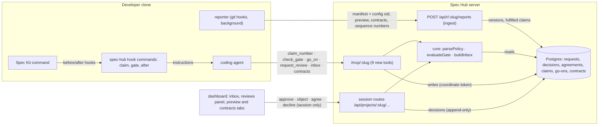
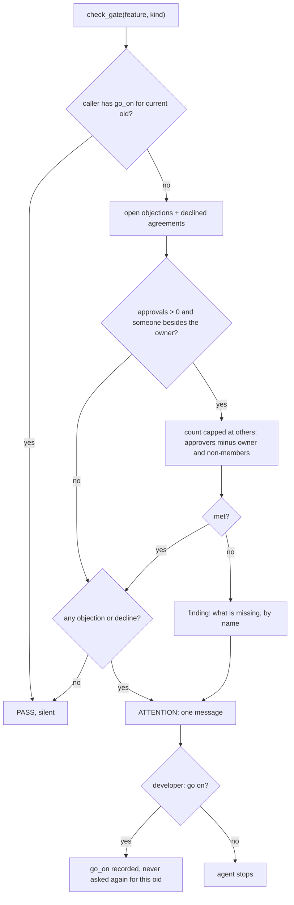
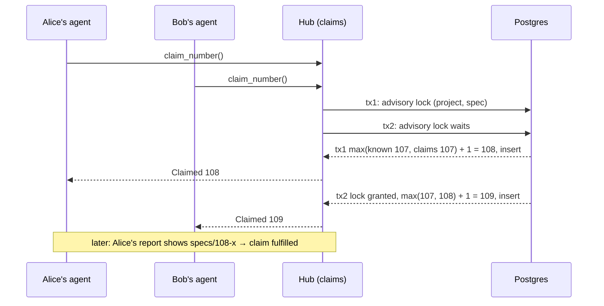

# Pre-Task Review: Coordination over MCP

## Architecture



Decisions reach the database only through the session routes. The MCP side can claim, request and
record go-ons, and nothing else.

## Critical Path Sketches

### 1. The policy: off unless the repo turns it on

`parsePolicy` reads the default branch's config. The format is flat `key: value`, the same as the
reporter's `cfg`. Unknown or bad keys are reported and fall back to their default, so a typo never
switches approvals on.

```ts
// packages/core/src/policy.ts
export const DEFAULT_POLICY: Policy = {
  spec: { approvals: 0, approvers: [] },
  plan: { approvals: 0, approvers: [] },
  selfApprovalCounts: false,
  approvalSurvivesChange: true,
  sequences: [],
}

const KNOWN = /^(hub_url|project|remote|(spec|plan)_(approvals|approvers)|self_approval_counts|approval_survives_change|sequence_[a-z][a-z0-9-]{0,30})$/

export function parsePolicy(text: string | null): PolicyResult {
  const policy = structuredClone(DEFAULT_POLICY)
  const errors: string[] = []
  if (text === null) return { policy, errors }
  if (text.length > 16_384) return { policy, errors: ['spec-hub-config.yml is over 16 KB; using defaults'] }
  for (const [n, raw] of text.split('\n').entries()) {
    const line = raw.replace(/\s+#.*$/, '').trim()
    if (line === '' || line.startsWith('#')) continue
    const m = line.match(/^([a-z_][a-z0-9_-]*):\s*(.*)$/)
    if (!m || !KNOWN.test(m[1])) { errors.push(`line ${n + 1}: unknown key`); continue }
    const [, key, value] = m
    const kind = key.startsWith('spec_') ? 'spec' : 'plan'
    if (key.endsWith('_approvals')) {
      const v = Number(value)
      if (Number.isInteger(v) && v >= 0 && v <= 10) policy[kind].approvals = v
      else errors.push(`line ${n + 1}: ${key} must be a whole number from 0 to 10`)
    } else if (key.endsWith('_approvers')) {
      policy[kind].approvers = parseApprovers(value, n + 1, errors)
    } else if (key === 'self_approval_counts' || key === 'approval_survives_change') {
      const b = parseBool(value)
      if (b === null) errors.push(`line ${n + 1}: ${key} must be true or false`)
      else policy[key === 'self_approval_counts' ? 'selfApprovalCounts' : 'approvalSurvivesChange'] = b
    } else if (key.startsWith('sequence_')) {
      addSequence(policy, key.slice('sequence_'.length), value, n + 1, errors)  // pattern, width, ≤5, no duplicates
    }
  }
  return { policy, errors }
}
```

### 2. The gate: requirement capped by who exists, plus objections

`evaluateGate` is pure. The server loads the rows; core decides. It covers:

- FR-016: the quorum;
- FR-016a: dropping approvers who are the owner or not members, and capping the count;
- FR-016b: go-ons;
- the edge cases: objections stay open, and "changed since".

```ts
// packages/core/src/gate.ts
export interface GateInput {
  kind: ReviewKind
  currentOid: string
  ownerUserId: string | null
  callerUserId: string
  policy: Policy
  members: { userId: string; githubLogin: string; role: 'admin' | 'member' }[]
  dependencyOwnerIds: string[]                          // owners of features this one depends on
  standing: { userId: string; verdict: 'approve' | 'object'; oid: string; reason: string | null }[]
  openRequests: { reviewerId: string; createdAt: number }[]
  declinedAgreements: { ownerId: string; targetDir: string; reason: string }[]
  goOn: boolean                                         // caller has go_on for (kind, currentOid)
}

export interface GateResult {
  pass: boolean
  findings: string[]            // each one a line; empty when pass
  offerReview: boolean
  missing: { approvals: number; approvers: string[] }
}

export function evaluateGate(g: GateInput): GateResult {
  const others = g.members.filter((m) => m.userId !== g.ownerUserId)
  const isOther = (id: string) => others.some((m) => m.userId === id)
  const k = g.policy[g.kind]

  // FR-016a: ask only for what the project can give
  const required = new Set<string>()
  for (const rule of k.approvers) {
    if (rule.kind === 'dependency-owners') g.dependencyOwnerIds.filter(isOther).forEach((id) => required.add(id))
    if (rule.kind === 'member') others.filter((m) => m.githubLogin === rule.login).forEach((m) => required.add(m.userId))
    // 'admin' means any admin other than the owner; handled as an "any of" group below
  }
  const needAdmin = k.approvers.some((r) => r.kind === 'admin') && others.some((m) => m.role === 'admin')
  const count = Math.min(k.approvals, others.length)

  const counting = g.standing.filter(
    (s) => s.verdict === 'approve'
      && (g.policy.approvalSurvivesChange || s.oid === g.currentOid)
      && (g.policy.selfApprovalCounts || s.userId !== g.ownerUserId),
  )
  const approvedBy = new Set(counting.map((s) => s.userId))
  const missingApprovers = [...required].filter((id) => !approvedBy.has(id))
  const adminMissing = needAdmin && !g.members.some((m) => m.role === 'admin' && approvedBy.has(m.userId) && m.userId !== g.ownerUserId)
  const missingCount = Math.max(0, count - approvedBy.size)

  const objections = g.standing.filter((s) => s.verdict === 'object')
  const findings = [
    ...objections.map((o) => `@${login(g, o.userId)} objects to ${g.kind}: "${o.reason ?? ''}"`),
    ...g.declinedAgreements.map((d) => `@${login(g, d.ownerId)} declined ${d.targetDir}: "${d.reason}"`),
    ...(missingCount > 0 || missingApprovers.length > 0 || adminMissing
      ? [missingLine(g, missingCount, missingApprovers, adminMissing)]
      : []),
  ]
  const approvalsOn = k.approvals > 0 && others.length > 0
  return {
    pass: findings.length === 0 || g.goOn,
    findings: g.goOn ? [] : findings,
    offerReview: approvalsOn && g.openRequests.length === 0 && missingCount + missingApprovers.length > 0,
    missing: { approvals: missingCount, approvers: missingApprovers.map((id) => login(g, id)) },
  }
}
```



### 3. The inbox: derived from rows, never stored

Every item comes from a request, agreement or decision row. A request is unique per reviewer while
open, so "exactly one item per person per request" holds by construction, and nothing has to be
cleaned up or kept in sync.

```ts
// packages/core/src/inbox.ts
export type InboxItem =
  | { kind: 'review'; requestId: string; dir: string; document: ReviewKind; from: string; at: number }
  | { kind: 'objection'; dir: string; document: ReviewKind; from: string; reason: string; at: number }
  | { kind: 'agreement'; agreementId: string; fromDir: string; targetDir: string; from: string; at: number }
  | { kind: 'declined'; agreementId: string; targetDir: string; from: string; reason: string; at: number }
  | { kind: 'approved' | 'agreed' | 'request-closed' | 'claim-lapsed'; dir: string; from: string; at: number }

export function buildInbox(me: string, rows: InboxRows, memberIds: Set<string>, now: number): Inbox {
  const left = (id: string) => !memberIds.has(id)
  const needsYou: InboxItem[] = []
  const waitingOn: InboxItem[] = []
  const updates: InboxItem[] = []
  for (const r of rows.openRequests) {
    if (r.reviewerId === me && !left(r.requesterId)) needsYou.push(review(r))
    if (r.requesterId === me) (left(r.reviewerId) ? updates.push(closed(r, 'left the project')) : waitingOn.push(review(r)))
  }
  for (const s of rows.standingOnMyFeatures) if (s.verdict === 'object' && s.userId !== me) needsYou.push(objection(s))
  for (const a of rows.agreements) {
    if (a.state === 'open' && a.ownerId === me) needsYou.push(agreement(a))
    if (a.state === 'open' && a.requesterId === me) waitingOn.push(agreement(a))
    if (a.state === 'declined' && a.requesterId === me) needsYou.push(declined(a))
    if (a.state === 'agreed' && a.requesterId === me) updates.push(agreed(a))
  }
  // approvals of my documents and lapsed claims of mine are updates; nothing about my own actions (FR-027)
  return { needsYou: byAge(needsYou), waitingOn: byAge(waitingOn), updates: recent(updates, now) }
}
```

### 4. Claims: one lock per sequence, lapse when read

```ts
// apps/server/src/services/coordination.ts
export async function claimNumber(db: Db, projectId: string, userId: string, sequence: string): Promise<number> {
  return db.transaction(async (tx) => {
    await tx.execute(sql`select pg_advisory_xact_lock(hashtext(${`${projectId}:${sequence}`}))`)
    const known = await highestKnown(tx, projectId, sequence)   // feature dirs or sequence numbers, all branches + default
    const [{ max }] = await tx
      .select({ max: sql<number | null>`max(${numberClaim.number})` })
      .from(numberClaim)
      .where(and(eq(numberClaim.projectId, projectId), eq(numberClaim.sequence, sequence)))
    const next = Math.max(known, max ?? 0) + 1                  // lapsed numbers never reused below a higher one
    await tx.insert(numberClaim).values({ projectId, sequence, number: next, userId, state: 'held' })
    return next
  })
}
// "lapsed" = state 'held' and claimed_at < now() - interval '7 days'; computed in queries, no job.
// Fulfilment: ingest marks held claims of the reporting user 'fulfilled' when the number appears.
```



## Assumptions (review these)

1. **Spec Kit prints a header for mandatory hooks.** Every `/speckit-specify`, `/speckit-plan` and
   `/speckit-implement` run shows Spec Kit's own "Automatic Hook: spec-hub … Executing" line. It's
   not a question and the hub says nothing more, but it is visible text. The alternative is
   optional hooks, which print a yes/no prompt every time, which is worse. A third option is no
   hooks at all, leaving agents to call the tools only when they think to, which loses the silent
   claim before specify.
2. **The agent follows the claimed number.** The claim hook tells the agent to use the number for
   the folder it creates. Stock `/speckit-specify` computes its own number by scanning `specs/`. In
   practice the agent obeys the hook's instruction, but nothing enforces it. A Spec Kit `git`
   extension that creates the branch first may already have picked a number. Then the claim and the
   folder can differ, and 001's collision flag still catches a clash.
3. **Count and approvers are per document kind; the two booleans are project-wide.**
   `self_approval_counts` and `approval_survives_change` apply to both spec and plan. FR-016 can be
   read as per kind; per-kind booleans would be 2 more keys if you want them.
4. **"Changed since" counts by default** (`approval_survives_change: true`, as FR-016 says): an
   approval of an older version still satisfies the gate and shows "changed since".
5. **Speculative-complexity check (Art. 7.4): the rename lookup (R3).** Failure mode: someone renames
   `104-ledger` to `104-ledger-settlement` after approval and the approval seems to vanish.
   Likelihood: low, a few times a year in the pilot. Cost: one fallback query of about 15 lines.
   **The spec asks for it, so it's included; say if you'd rather drop it and accept a re-approval on
   rename.**
6. **Speculative-complexity check: the sequences (FR-017a).** Reporter cost: one `ls-tree` per
   sequence per branch, in the background. Hub cost: about 60 lines plus a jsonb column. It's in the
   spec and the pilot hits ADR clashes, so it's included, but it's the last slice and could move to
   a later feature if you want 002 smaller.
7. **No reminders and no lapse job.** Lapsed claims and "reviewer left" are computed when read.
   Nothing runs on a timer.
8. **The session line is documented, not installed.** No one gets the `SessionStart` line unless they
   add the snippet (R12, Art. 2.4).
9. **Existing tokens gain `coordinate` in the migration.** Anyone whose token could read can now also
   claim, request and record go-ons. The hub still checks the permission on every write tool, but
   the Tokens page gets no "read only" choice until someone asks for one (restraint review).

**Review this before proceeding. Run /speckit-tasks when satisfied, or give feedback to revise the
plan.**
