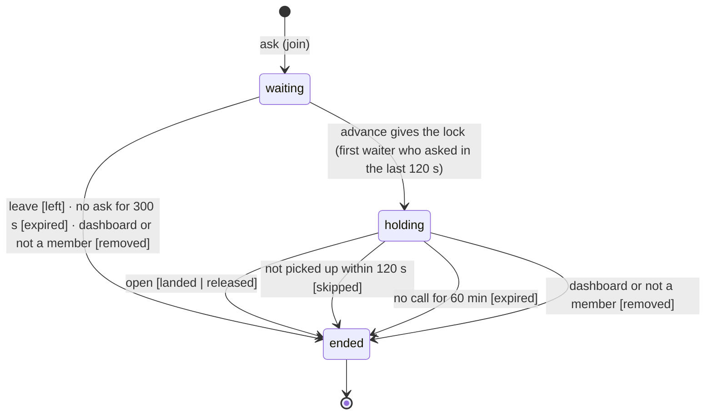

# Data Model: Landing lock

One migration, `0004_landing_queue`. It was rewritten in place for the 2026-10-30 revision: it had
never been applied outside test databases.

## Enums

- `land_state`: `waiting`, `holding`, `ended`.
- `land_outcome`: `landed`, `released`, `expired`, `skipped`, `left`, `removed`.

## Table: land_place

| Column | Type | Notes |
|---|---|---|
| id | bigserial pk | Also the queue order (first come, first served). |
| project_id | uuid → project (cascade) | |
| user_id | text → user (cascade) | The member who asked. |
| state | land_state | |
| outcome | land_outcome null | Set exactly when `state = 'ended'` (check constraint). |
| asked_at | timestamptz | |
| started_at | timestamptz null | When the lock was given to this place. |
| ended_at | timestamptz null | |
| checked_in_at | timestamptz | The member's last call (ask, view). |
| ended_by | text → user null (set null) | The member who opened or removed it on the dashboard. |

**Indexes and constraints:**

- `land_place_live_member`: unique `(project_id, user_id) WHERE state <> 'ended'` — one live place
  per member (FR-002).
- `land_place_holder`: unique `(project_id) WHERE state = 'holding'` — one holder (FR-001).
- `(project_id, id)`: the live queue in order and the history newest first.
- Check: `(state = 'ended') = (outcome IS NOT NULL)`.

## State machine

- **Picked up.** A grant sets `started_at = now` and leaves `checked_in_at` alone. The place is
  picked up once a call from the member arrives at or after the grant (`checked_in_at >=
  started_at`); a grant made inside the member's own call counts at once. Before that, the
  pick-up timeout (120 s) applies; after it, the hold timeout (60 min).
- **Ended places never change.** Updates touch only rows with `state <> 'ended'`.

## Derived values

- **Position**: waiting places ahead + 1.
- **Estimate**: `estimateMinutes` over `ended_at − started_at` of the last 10 `landed` places.
- **Notice**: the member's newest place, if it is ended `expired` and ended within the last hour.

## Unchanged

`project`, `membership` and `security_event` are 001's. Security events gain the type
`land_removed` with detail `{ placeId, owner }` for dashboard actions on another member's place.
