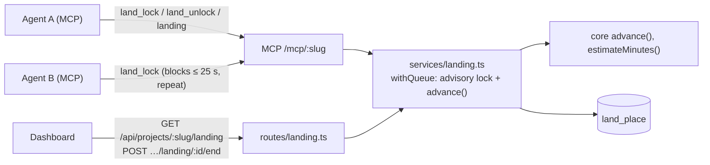

# Preview: Landing lock (revised 2026-10-30)

## Architecture



## 1. `advance` with the revised timeouts

```ts
export const PICKUP_MS = 120_000
export const WAIT_MS = 300_000
export const HOLD_MS = 60 * 60_000

for (const p of places) {
  if (!p.member) changes.push({ id: p.id, end: 'removed' })
  else if (p.state === 'holding' && !p.pickedUp && now - (p.startedAt ?? 0) > PICKUP_MS)
    changes.push({ id: p.id, end: 'skipped' })
  else if (now - p.checkedInAt > (p.state === 'holding' ? HOLD_MS : WAIT_MS))
    changes.push({ id: p.id, end: 'expired' })
  else live.push(p)
}
// grant: first waiter heard from within PICKUP_MS, as before
```

`pickedUp = checkedInAt >= startedAt`; the grant sets `started_at` only.

## 2. `land_lock`: a blocking ask

```ts
async function ask(db: Db, c: Member, deadlineMs = 25_000): Promise<Status> {
  const until = Date.now() + deadlineMs
  for (;;) {
    const s = await poll(db, c)            // join if needed, check in, settle, status
    if (s.state === 'holding' || Date.now() + 2_000 > until) return s
    await new Promise((r) => setTimeout(r, 2_000))
  }
}
```

Each `poll` is one short transaction under the project's advisory lock, so a waiting ask holds no
connection between checks. A client disconnect only wastes the remaining checks.

## 3. Dashboard open

`endById(db, project, placeId, byUserId)`: under `withQueue`, find the live place by id within the
project (404 otherwise); own place → `released`/`left`; someone else's → `removed`, `ended_by`, and a
`land_removed` security event; then `settle` so the next waiter is granted at once.

## Assumptions

- Agents follow the tool descriptions (ask again while waiting; unlock when done).
- A 25 s tool call is acceptable to MCP clients (Claude Code's default tool timeout is far longer).
- One place per member is enough; a member landing from two agents at once takes turns with
  themselves only through the shared place.
