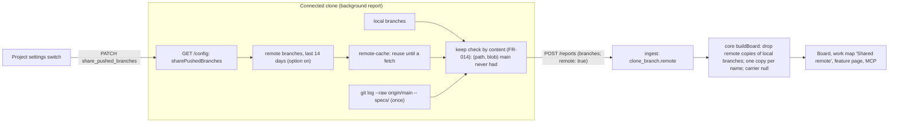
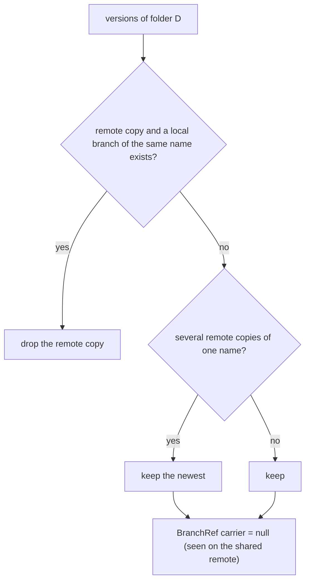

# Pre-task review: Teammates' pushed work on the board

## Architecture



## Critical path sketches

### 1. Content-based keep check (all reports)

Replaces `KEEP_AWK`'s cherry-pick log. The "had" set is built once per report, only when some branch
has a folder that is also on main (the existing `ONBASE` path).

```sh
# main_had: $TMP/had, "path blob" for every document version the default branch ever had.
main_had() {
  [ -f "$TMP/had" ] && return 0
  git log --no-show-signature --format= --raw --no-abbrev -z "$base" -- specs/ |
    tr '\n\000' '\001\n' | awk 'raw blob/path pairs → print "path blob" for src and dst' > "$TMP/had"
}
```

```awk
# KEEP_AWK (new): reads $TMP/had, then the ONBASE lines; prints C lines that hold a version main
# never had, as F lines (at most 200 per branch, as today).
FILENAME == ARGV[1] { had[$0] = 1; next }
{
  split($0, f, "\t")                 # C <tab> dir <tab> at <tab> spec <tab> plan <tab> tasks <tab> extra <tab> owner
  d = f[2]; fresh = 0
  if (newdoc(d, "spec.md", f[4]) || newdoc(d, "plan.md", f[5]) || newdoc(d, "tasks.md", f[6])) fresh = 1
  if (!fresh && extra_fresh(d, f[7])) fresh = 1            # extras: "name":"…","oid":"…" pairs
  if (fresh && ++c <= 200) { sub(/^C/, "F"); print }
}
function newdoc(d, name, ref,   oid) {
  if (ref == "-") return 0                                 # absent on the branch: says nothing new
  oid = substr(ref, 1, index(ref, " ") - 1)
  return !(("specs/" d "/" name " " oid) in had)
}
```

A branch whose documents for a folder are all absent or all "had" carries nothing for it. A folder
that is not on main at all is reported as today (its documents are new by definition).

### 2. Remote branch pass with a cache (option on)

```sh
remote_branches() {   # appends B/F lines for remote branches to $TMP/data
  [ "$SHARE" = true ] && [ -n "$base" ] || return 0
  cut=$(( $(date +%s) - 14 * 86400 ))
  git for-each-ref --no-merged="$base" --format='%(refname)%09%(objectname)%09%(committerdate:unix)' \
    "refs/remotes/$remote/" | awk -v cut="$cut" -F '\t' '$3 >= cut && $1 !~ /\/HEAD$/' |
    drop_local_names | drop_private > "$TMP/rlist"
  key=$({ cat "$TMP/rlist"; printf '%s\n%s\n' "$base_tip" "$extra"; cat "$TMP/private"; } | git hash-object --stdin)
  if [ "$(sed -n 1p "$S/remote-cache" 2>/dev/null)" = "$key" ]; then
    sed 1d "$S/remote-cache" >> "$TMP/data"; return 0
  fi
  : > "$TMP/rdata"
  while IFS="$tab" read -r ref tip tip_at; do
    printf 'B\t%s\t%s\t%s\ttrue\tremote\n' "${ref#refs/remotes/$remote/}" "$tip" "$tip_at"
    branch_features "$ref" "$tip_at"
  done < "$TMP/rlist" > "$TMP/rdata"
  { printf '%s\n' "$key"; cat "$TMP/rdata"; } > "$S/remote-cache.$$" && mv -f "$S/remote-cache.$$" "$S/remote-cache"
  cat "$TMP/rdata" >> "$TMP/data"
}
```

`BRANCHES_AWK` emits `,"remote":true` for B lines with the `remote` marker. Local branches are listed
first, so the 500 limit drops remote ones before local ones.

### 3. Hub: dedupe and carrier (core `buildBoard`)

```ts
// within one folder's versions, before sorting
function dropRemoteCopies(group: FeatureVersion[]): FeatureVersion[] {
  const localNames = new Set(group.filter((v) => !v.remote).map((v) => v.branch))
  const remote = new Map<string, FeatureVersion>()
  for (const v of group) {
    if (!v.remote || localNames.has(v.branch)) continue
    const kept = remote.get(v.branch)
    if (!kept || v.lastChangeAt > kept.lastChangeAt ||
        (v.lastChangeAt === kept.lastChangeAt && v.carrierUserId < kept.carrierUserId)) remote.set(v.branch, v)
  }
  return [...group.filter((v) => !v.remote), ...remote.values()]
}
// BranchRef: carrierUserId: v.remote ? null : v.carrierUserId
```

`buildWorkMap` puts `carrierUserId: null` branches under `person:remote` ("Shared remote").
Owner stays `resolveOwner(shown, members)`; for a remote copy that is the spec's owner header or its
first committer, never the reporting person.



## Assumptions

- The shared remote is the one spec 001 already reads (`remote:` in the repo config, default
  `origin`).
- A remote branch whose short name equals a local branch of the reporting clone is that branch (the
  local copy wins, FR-004 edge case).
- 14 days means a commit (committer date) within 14 days of the report, the same window as staleness.
- `(path, blob)` over main's full reachable history is the "versions main ever had". A branch tip
  merged into main counts as had (correct: it landed).
- A branch that only changes non-document files of a landed feature no longer carries it; its own
  branch still counts as activity (FR-016 of spec 001).
- The cache is per clone (in the git common dir), invalidated by any change to the remote refs list,
  main's tip, private prefixes or extra document names; a crashed write leaves the old cache or none.
- Members' views of who carries what change: remote copies show as "seen on the shared remote".

**Review this before proceeding. Run /speckit-tasks when satisfied, or give feedback to revise the
plan.**
