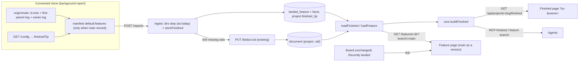
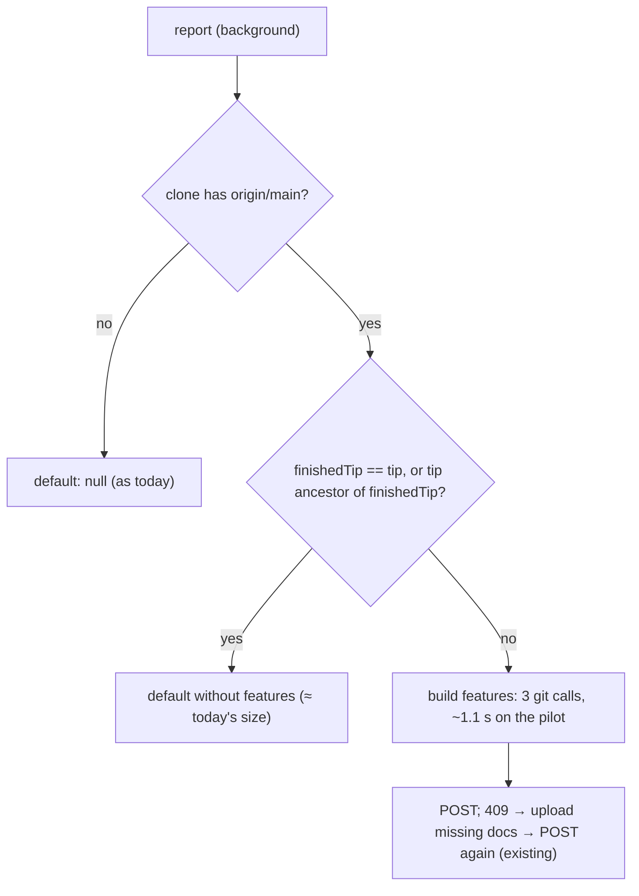

# Pre-task review: Finished features on the hub

## Architecture



## Critical path sketches

### 1. The reporter's listing, and when it is skipped

The listing is built only when the hub does not already have this default-branch tip (or a newer one
containing it). One awk pass reads three git outputs separated by `\003` lines, the same pattern as
`FEATURES_AWK`, and reuses `JS_AWK` and `OWNER_AWK`.

```sh
# default_features: sets FEATURES to ',"features":[…]' or to nothing when the hub already has
# this default branch (research F2).
default_features() {
  FEATURES=
  hub_tip=$(tr -d '\n' < "$TMP/config" |
    sed -n 's/.*"finishedTip"[[:space:]]*:[[:space:]]*"\([0-9a-f]*\)".*/\1/p')
  if [ "$hub_tip" = "$base_tip" ] ||
     { [ -n "$hub_tip" ] && git merge-base --is-ancestor "$base_tip" "$hub_tip" 2>/dev/null; }; then
    return 0
  fi
  {
    git ls-tree -r -t -z -l "$base" -- specs/
    printf '\003\000'
    git log --no-show-signature --first-parent --diff-merges=first-parent -z \
      --format=%x01%ct --name-only "$base" -- specs/
    printf '\003\000'
    git log --no-show-signature -M -z --diff-filter=AR \
      --format=%x01%ct%x1f%an%x1f%ae --name-status "$base" -- specs/
  } | tr '\n\000' '\001\n' | awk -v now="$(date +%s)" "$DEFAULT_AWK" > "$TMP/finished" || return 0
  FEATURES=",\"features\":[$(cat "$TMP/finished")]"
}
```

```awk
# DEFAULT_AWK = JS_AWK OWNER_AWK + this (meta, dirpart, docjs, authorjs, clamp as in FEATURES_AWK
# and BRANCHES_AWK, moved to a shared snippet)
function owner_found(d) { who[d] = WHO }                 # newest first: the last add is the oldest
$0 == "\003" { if (++sec == 2) for (d in tree) tgt["specs/" d "/spec.md"] = d; next }
sec == 0 {                                               # ls-tree -r -t -l
  if (!index($0, "\t") || !dirpart(meta($0, m))) next
  if (F == "") { if (m[2] == "tree" && length(D) <= 255 && D !~ /[[:cntrl:]]/) { tree[D] = 1; order[++n] = D } }
  else if (m[2] == "blob" && (F == "spec.md" || F == "plan.md" || F == "tasks.md")) doc[D, F] = m[3] " " m[4]
  next
}
sec == 1 {                                               # first-parent log, newest first
  if ($0 ~ /^\001[0-9]+$/) { T = substr($0, 2); next }
  p = $0; sub(/^\001/, "", p)
  if (dirpart(p) && F != "") { if (!(D in last)) last[D] = T; added[D] = T }
  next
}
{ owner_line($0) }                                       # owner log (OWNER_AWK)
END {
  for (k = 1; k <= n && k <= 2000; k++) {
    d = order[k]
    printf "%s{\"dir\":%s,\"addedAt\":%s,\"lastChangeAt\":%s,\"author\":%s,\"docs\":{\"spec\":%s,\"plan\":%s,\"tasks\":%s}}", \
      (k > 1 ? "," : ""), js(d), clamp(added[d] + 0), clamp(last[d] + 0), authorjs(who[d]), \
      docjs(docref(d, "spec.md")), docjs(docref(d, "plan.md")), docjs(docref(d, "tasks.md"))
  }
}
```

`build_manifest` calls `default_features` after computing `$base_tip` and appends `$FEATURES` inside
the `default` object, after `dirs`. Any git failure leaves `FEATURES` empty: the report goes out as
today (fail open).



### 2. Ingest: applying a listing

A separate step from the `dirs` step, with its own watermark, so an older reporter (no `features`)
and a newer one never step on each other. Same transaction and row lock as today.

```ts
// services/ingest.ts, called after advanceDefaultBranch inside ingestReport's transaction
async function storeFinished(tx: Tx, projectId: string, d: DefaultBranchReport): Promise<void> {
  if (!d.features) return
  const [p] = await tx.select().from(projectT).where(eq(projectT.id, projectId)).for('update')
  if (!p || d.branch !== p.defaultBranch) return
  const tipAt = new Date(d.tipAt * 1000)
  if (p.finishedTipAt && p.finishedTipAt >= tipAt) return // an older or the same listing (FR-005)
  await tx.update(projectT).set({ finishedTip: d.tip, finishedTipAt: tipAt }).where(eq(projectT.id, projectId))

  const listed = d.features.map((f) => f.dir)
  // removed or renamed on the default branch (FR-011)
  await tx
    .delete(landedFeatureT)
    .where(and(eq(landedFeatureT.projectId, projectId), listed.length > 0 ? notInArray(landedFeatureT.dir, listed) : undefined))
  if (d.features.length === 0) return

  const firstSeenAt = new Date()
  const baseline = isBaseline(p, tipAt) // the dirs step's rule, extracted: no earlier tip, or tip older than the project
  const facts = (f: DefaultFeature) => ({
    addedAt: new Date(f.addedAt * 1000),
    lastChangeAt: new Date(f.lastChangeAt * 1000),
    authorName: f.author?.name ?? null,
    authorEmail: f.author?.email ?? null,
    specOid: f.docs.spec?.oid ?? null, specSize: f.docs.spec?.size ?? null,
    planOid: f.docs.plan?.oid ?? null, planSize: f.docs.plan?.size ?? null,
    tasksOid: f.docs.tasks?.oid ?? null, tasksSize: f.docs.tasks?.size ?? null,
  })
  await tx
    .insert(landedFeatureT)
    .values(d.features.map((f) => ({ projectId, dir: f.dir, firstSeenAt, baseline, ...facts(f) })))
    .onConflictDoUpdate({
      target: [landedFeatureT.projectId, landedFeatureT.dir],
      // first_seen_at and baseline keep their first value: when the hub first saw it
      set: excludedSet(landedFeatureT, ['addedAt', 'lastChangeAt', 'authorName', 'authorEmail',
        'specOid', 'specSize', 'planOid', 'planSize', 'tasksOid', 'tasksSize']),
    })
}
```

`excludedSet` is a three-line local helper mapping each column to `sql.raw('excluded.<column>')`.
The missing-documents check and the too-large markers already run before any write; both iterate a
shared `manifestDocs(manifest)` that now yields the default branch's documents too.

### 3. Core: one finished feature from one row

Pure and unit-tested; the list, the feature page and the MCP tool all use it.

```ts
// packages/core/src/finished.ts
export function finishedFeature(
  r: FinishedRow,
  members: MemberIdentity[],
  numbering: Numbering,
  activeDirs: ReadonlySet<string>,
): FinishedFeature {
  return {
    dir: r.dir,
    number: featureNumber(r.dir, numbering),
    title: r.spec?.title ?? titleFromDir(r.dir),
    owner: resolveOwner(r, members), // FR-015 of spec 001, unchanged
    landedAt: r.baseline ? r.addedAt : r.firstSeenAt,
    lastChangeAt: r.lastChangeAt,
    tasks: r.tasks && r.tasks.tasksTotal > 0 ? { done: r.tasks.tasksDone, total: r.tasks.tasksTotal } : null,
    reported: r.addedAt !== null,
    inFlight: activeDirs.has(r.dir),
  }
}

export function buildFinished(
  rows: FinishedRow[],
  members: MemberIdentity[],
  numbering: Numbering,
  activeDirs: ReadonlySet<string>,
): FinishedFeature[] {
  return rows
    .map((r) => finishedFeature(r, members, numbering, activeDirs))
    .sort((a, b) => (b.landedAt ?? -1) - (a.landedAt ?? -1) || (a.dir < b.dir ? -1 : a.dir > b.dir ? 1 : 0))
}

/** The list's text filter: a number match first, then title or folder name. */
export function matchFinished(list: FinishedFeature[], query: string, owner?: string): FinishedFeature[] {
  const q = query.trim().toLowerCase()
  const byOwner = owner ? list.filter((f) => ownerKey(f.owner) === owner.toLowerCase()) : list
  if (!q) return byOwner
  const exact = byOwner.filter((f) => f.number === q)
  const rest = byOwner.filter((f) => f.number !== q && `${f.title} ${f.dir}`.toLowerCase().includes(q))
  return [...exact, ...rest]
}
```

`matchFinished` lives in core so the web page and the MCP tool filter the same way.

### 4. The feature page's default-branch version

`loadFeature` keeps choosing the in-flight version by default; the default branch is chosen when
asked for, or when it is the only one.

```ts
// services/board-query.ts, in loadFeature
const mainDocs = landedRow && landedRow.addedAt ? docsOf(landedRow) : null // spec/plan/tasks refs
const wantsMain = branch === proj.defaultBranch || versions.length === 0
const shownVersion = wantsMain && mainDocs ? null : ((branch ? versions.find((v) => v.branch === branch) : undefined) ?? versions[0])
const shown = shownVersion
  ? await shownDocs(db, projectId, shownVersion.branch, shownVersion.docs)
  : mainDocs ? await shownDocs(db, projectId, proj.defaultBranch, mainDocs) : null
```

`shownDocs` is the existing document-loading block, extracted so both paths use it. On the web, the
branch picker lists `versions` plus `landed.branch` when `landed.finished.reported`.

## Assumptions

- One clone per project is enough to keep the list current; nobody needs to know which clone sent it.
- `firstSeenAt` is a good landing time for features that land after connecting (reports follow
  pulls within minutes), and `addedAt` from first-parent history is good for the history before.
- A listing truncated at 2,000 folders is acceptable to never handle better (pilot: 136).
- The first full upload (~400 documents) completing within one background report on a normal
  connection is acceptable without batching; the clone's in-flight changes reach the board one
  report later that once (research F5).
- Rows written only by old reporters (no facts) show in the list by folder name with "documents not
  reported yet" until any updated clone reports.
- Removing a folder from the default branch removes the finished feature, including from "Recently
  landed"; nothing keeps deleted history (git has it).
- `document` rows are never garbage-collected (as today); removed features' documents stay cached.
- Spec 001's contracts get a short pointer to `contracts/reporter.md` rather than being rewritten.

**Review this before proceeding. Run /speckit-tasks when satisfied, or give feedback to revise the
plan.**
