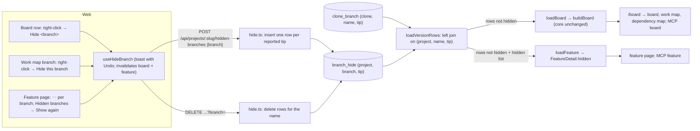
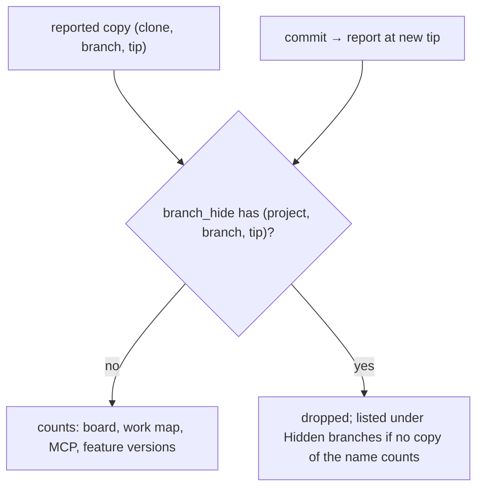

# Pre-task review: Hide a leftover branch

## Architecture



## Critical path sketches

### 1. One filter at the source

```ts
// apps/server/src/services/board-query.ts — loadVersionRows gains the tip and the matching hide
const rows = await db
  .select({
    /* …existing columns… */
    tip: cloneBranch.tip,
    hiddenAt: branchHide.hiddenAt,           // null when not hidden
    hiddenBy: branchHide.hiddenBy,
  })
  .from(cloneFeature)
  /* …existing joins… */
  .leftJoin(
    branchHide,
    and(
      eq(branchHide.projectId, clone.projectId),
      eq(branchHide.branch, cloneBranch.name),
      eq(branchHide.tip, cloneBranch.tip),
    ),
  )
  .where(eq(clone.projectId, projectId))

// loadBoard
const versions = versionRows.filter((r) => r.hiddenAt === null).map(toFeatureVersion)

// loadFeature
const rows = (await loadVersionRows(db, projectId)).filter((v) => v.dir === dir)
const visible = rows.filter((v) => v.hiddenAt === null)
const hidden = hiddenBranches(rows.filter((v) => v.hiddenAt !== null), members)
if (visible.length === 0 && hidden.length === 0 && !landed) return null
```

`hiddenBranches` groups by branch name and keeps a branch only when **none** of its copies for this
dir is visible (a copy at a new tip counts, so the branch is not "hidden" any more), with the
earliest `hiddenAt` and its hider.



### 2. Hide and show

```ts
// apps/server/src/services/hide.ts
export async function hideBranch(db: Db, projectId: string, branch: string, userId: string) {
  const tips = await db
    .selectDistinct({ tip: cloneBranch.tip })
    .from(cloneBranch)
    .innerJoin(clone, eq(clone.id, cloneBranch.cloneId))
    .where(and(eq(clone.projectId, projectId), eq(cloneBranch.name, branch)))
  if (tips.length === 0) return null
  await db
    .insert(branchHide)
    .values(tips.map(({ tip }) => ({ projectId, branch, tip, hiddenBy: userId })))
    .onConflictDoNothing()
  return { branch, tips: tips.length }
}

export const showBranch = (db: Db, projectId: string, branch: string) =>
  db.delete(branchHide).where(and(eq(branchHide.projectId, projectId), eq(branchHide.branch, branch)))
```

```ts
// apps/server/src/routes/board.ts
const branchName = z.string().min(1).max(255).regex(/^[^\u0000-\u001f]+$/)
  .post('/projects/:slug/hidden-branches', ...guard, zv('json', z.object({ branch: branchName })), async (c) => {
    const r = await hideBranch(db, c.var.project.id, c.req.valid('json').branch, c.var.userId)
    return r ? c.json(r) : c.json({ error: 'no such branch' }, 404)
  })
  .delete('/projects/:slug/hidden-branches', ...guard, zv('query', z.object({ branch: branchName })), async (c) => {
    await showBranch(db, c.var.project.id, c.req.valid('query').branch)
    return c.body(null, 204)
  })
```

### 3. Web entry points

```tsx
// apps/web/src/features/hide/use-hide-branch.ts
export function useHideBranch(slug: string) {
  const qc = useQueryClient()
  const refresh = () => Promise.all([
    qc.invalidateQueries({ queryKey: ['board', slug] }),
    qc.invalidateQueries({ queryKey: ['feature', slug] }),
  ])
  const show = useMutation({ mutationFn: (branch: string) => api.showBranch(slug, branch), onSuccess: refresh })
  const hide = useMutation({
    mutationFn: (branch: string) => api.hideBranch(slug, branch),
    onSuccess: async (_, branch) => {
      await refresh()
      toast(`Hid ${branch} for everyone.`, { action: { label: 'Undo', onClick: () => show.mutate(branch) } })
    },
  })
  return { hide, show }
}
```

```tsx
// Board row (feature-list.tsx): the row's existing markup becomes the trigger
<ContextMenu>
  <ContextMenuTrigger asChild><TableRow …>{/* unchanged */}</TableRow></ContextMenuTrigger>
  <ContextMenuContent>
    <ContextMenuItem onSelect={() => copyLink(`${location.origin}/p/${slug}/f/${entry.dir}`)}>
      <Link /> Copy link
    </ContextMenuItem>
    <ContextMenuSeparator />
    <ContextMenuLabel>Hide a branch (for all its features)</ContextMenuLabel>
    {entry.branches.map((b) => (
      <ContextMenuItem key={b.branch} onSelect={() => hide.mutate(b.branch)}>
        <EyeOff /> Hide <span className="font-mono">{b.branch}</span>
      </ContextMenuItem>
    ))}
  </ContextMenuContent>
</ContextMenu>
```

The work map wraps the branch node's body in the same `ContextMenu` (one item, "Hide this branch");
the node gets the action through node data (`data.onHide`), so `GraphCanvas` does not change. The
feature page's Branches list gets a `DropdownMenu` `⋯` button per branch and a "Hidden branches"
section from `detail.hidden`.

## Assumptions

- A hide covers every tip the hub has for the name when the member clicks, including other clones'
  copies at different tips (spec FR-002); a copy at a tip that was not there then counts.
- Board rows list `entry.branches` (already in `BoardEntry`); remote copies (spec 004) have the same
  branch name and are covered by name + tip.
- The Finished page, Recently landed and the landing queue read no hidden state and do not change.
- Constitution 1.2.0 is MINOR: Art. 3.1 gains an exception clause; the inferred-status rule stays.
- No undo history beyond the toast: "Show again" is the undo afterwards.

**Review this before proceeding. Run /speckit-tasks when satisfied, or give feedback to revise the
plan.**
