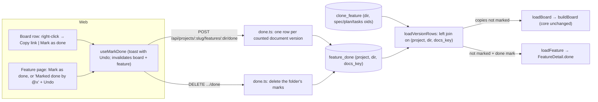
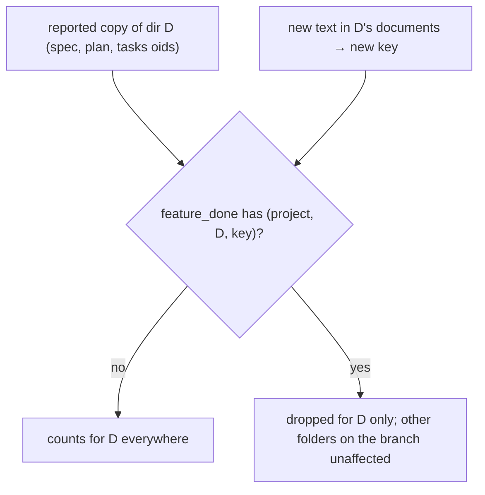

# Pre-task review: Mark a spec as done

## Architecture



## Critical path sketches

### 1. The key and the join

```ts
// apps/server/src/services/board-query.ts
const docsKey = sql<string>`coalesce(${cloneFeature.specOid}, '-') || ':' || coalesce(${cloneFeature.planOid}, '-') || ':' || coalesce(${cloneFeature.tasksOid}, '-')`

// loadVersionRows
  .leftJoin(
    featureDone,
    and(
      eq(featureDone.projectId, clone.projectId),
      eq(featureDone.dir, cloneFeature.dir),
      eq(featureDone.docsKey, docsKey),
    ),
  )
  // select: docsKey, doneAt: featureDone.doneAt, doneBy: featureDone.doneBy

// loadBoard: versionRows.filter((r) => r.doneAt === null)
// loadFeature: visible = rows.filter((r) => r.doneAt === null)
//   done = visible.length === 0 && marked.length > 0 ? earliest(marked) with user lookup : null
//   return null only when visible, marked and landed are all empty
```



### 2. Mark and undo

```ts
// apps/server/src/services/done.ts
export async function markDone(db: Db, projectId: string, dir: string, userId: string) {
  const keys = await db
    .selectDistinct({ key: docsKey })
    .from(cloneFeature)
    .innerJoin(clone, eq(clone.id, cloneFeature.cloneId))
    .innerJoin(membership, and(eq(membership.projectId, clone.projectId), eq(membership.userId, clone.userId)))
    .where(and(eq(clone.projectId, projectId), eq(cloneFeature.dir, dir)))
  if (keys.length === 0) return null
  await db.insert(featureDone)
    .values(keys.map(({ key }) => ({ projectId, dir, docsKey: key, doneBy: userId })))
    .onConflictDoNothing()
  return { dir, versions: keys.length }
}
export const unmarkDone = (db: Db, projectId: string, dir: string) =>
  db.delete(featureDone).where(and(eq(featureDone.projectId, projectId), eq(featureDone.dir, dir)))
```

`docsKey` is exported from one module and used by both the join and `markDone`, so the two can
never compute the key differently.

### 3. Web

```tsx
// board row menu (feature-list.tsx)
<ContextMenuItem onSelect={() => copyLink(featureUrl(slug, entry.dir))}><Link /> Copy link</ContextMenuItem>
<ContextMenuSeparator />
<ContextMenuItem onSelect={() => mark.mutate({ dir: entry.dir, title: entry.title })}><CircleCheck /> Mark as done</ContextMenuItem>

// feature page header
{detail.done
  ? <p>Marked done by @{login}, {ago}. It shows again when its documents change. <Button onClick={() => undo.mutate(dir)}>Undo</Button></p>
  : detail.entry ? <Button variant="outline" onClick={() => mark.mutate({ dir, title })}><CircleCheck /> Mark as done</Button> : null}
```

## Assumptions

- Marked versions are those the project's member clones report now (the board's own population).
- A preview-only edit does not bring a done spec back (research D3).
- Branch hiding is removed, including its table (any pilot hides are dropped).
- Constitution stays 1.2.0 (not yet merged), with the exception reworded.

**Review this before proceeding. Run /speckit-tasks when satisfied, or give feedback to revise the
plan.**
