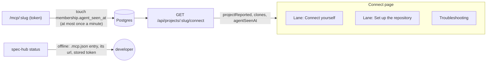

# Preview: Connect in two lanes, with troubleshooting

## Architecture



## 1. Page layout

The page opens on a lane chosen once, when the data first loads: **Connect yourself** if the
project has had any report, otherwise **Set up the repository**. Switching is one click and
never flips back by itself.

```
Connect ai-gateway
┌──────────────────────────────────────┬──────────────────────────────┐
│ [ Connect yourself ][ Set up the repo]│ Troubleshooting              │
│  each developer, each clone           │ ▸ connect: no hub configured │
│                                       │ ▸ connect: token rejected    │
│ ① Create a token          [Create]    │ ▸ Nothing on the board       │
│ ② Connect this clone                  │ ▸ Hooks are team-managed     │
│    sh …/spec-hub connect      [Copy]  │ ▸ Claude Code: no spec-hub   │
│    ✓ 12 features reported             │ ▸ /mcp: spec-hub failed      │
│ ③ Check your agent                    │                              │
│    [Claude Code][VS Code][Cursor][…]  │ First: run                   │
│    Start Claude Code in the clone,    │ sh …/spec-hub status  [Copy] │
│    approve "spec-hub", ask "What is   │                              │
│    the team working on?"              │                              │
│    ✓ Your agent called the hub 1m ago │                              │
│ Worktrees: nothing to do. Another     │                              │
│ clone: run connect there (no token).  │                              │
└──────────────────────────────────────┴──────────────────────────────┘
```

**Set up the repository**, once, by one person:

1. Add the extension: `specify extension add spec-hub --from …` (answer y once)
2. Link it to the project: `.specify/extensions/spec-hub/spec-hub-config.yml`
3. *Only if the repository sets `core.hooksPath`*: `spec-hub hooks "$(git config core.hooksPath)"`
4. Add the agent server: `spec-hub mcp` (writes `.mcp.json`), and allow its tools in
   `.claude/settings.json`
5. Commit: `git add .specify/extensions/spec-hub .mcp.json .claude/settings.json && git commit -m "Connect Spec Hub"`
   (plus the hooks directory when step 3 applied), then merge it like any change.

It ends with "Now connect yourself →", which switches lanes.

Removed from the page: the personal `claude mcp add … --header` command (a local entry
overrides the team's `.mcp.json` and keeps a stale token) and the `${SPEC_HUB_TOKEN}` variant
(Claude Code strips variables named `*TOKEN*` from a project helper's environment). The README
keeps the env variant for teams without the extension.

## 2. Troubleshooting entries (checked against the Claude Code docs, 2026-11-25)

| Symptom | Cause | Fix |
|---|---|---|
| connect: "no hub configured" / script not found | The setup isn't on this branch | `git pull` the default branch; or set up the repository |
| connect: "token rejected" | Token revoked or mistyped (connect already removed it) | Create a token, run connect again; then reconnect the agent |
| Nothing on the board after connect | Only features whose docs have text the default branch never had count | `spec-hub status`: last report and last error |
| connect: "Hooks are team-managed … missing" | The repo's hooks dir lacks the line | Once, for the team: `spec-hub hooks <dir>` and commit |
| Claude Code has no spec-hub server | `.mcp.json` isn't on this branch, the prompt was declined, or Claude was started in a subdirectory | `git pull`; `claude mcp reset-project-choices` and restart; start Claude Code at the repo root |
| `/mcp` shows spec-hub "Failed to connect" | The helper had no token (started before connect, folder not trusted yet), or the token was revoked (a 401 shows as failed, not as a sign-in) | Run connect, accept the folder trust prompt, then `/mcp` → spec-hub → Reconnect. To see why: `CLAUDE_CODE_MCP_SERVER_URL=<mcp url> sh …/spec-hub mcp-headers` |
| Your edits to spec-hub don't take effect / it uses an old token | A personal entry with the same name wins over `.mcp.json` | `claude mcp list` warns about it; `claude mcp remove spec-hub --scope local` (and `--scope user`) |

## 3. `status` reports the agent setup (FR-009)

```sh
  # in cmd_status, after "Connected:"; offline like the rest
  if [ -n "$HUB_URL" ] && [ -n "$PROJECT" ]; then
    url="$HUB_URL/mcp/$PROJECT"
    if [ ! -f .mcp.json ] || ! grep -qF "$SELF mcp-headers" .mcp.json; then
      printf 'Agent:       no spec-hub server in .mcp.json; run: sh %s mcp (or pull the branch that has it)\n' "$SELF"
    elif ! grep -qF "\"$url\"" .mcp.json; then
      printf 'Agent:       .mcp.json has another address; spec-hub'"'"'s url must be %s\n' "$url"
    elif [ "$connected" = no ]; then
      printf 'Agent:       no token yet; run: sh %s connect\n' "$SELF"
    else
      printf 'Agent:       ready (%s); in Claude Code, /mcp should show spec-hub connected\n' "$url"
    fi
  fi
```

## 4. Agent step ticks itself (FR-006, if chosen)

```ts
// schema.ts, membership: when the hub last saw an MCP call from this member to this project
agentSeenAt: timestamp('agent_seen_at', { withTimezone: true }),

// mcp/handler.ts, before mcp.fetch: at most one write a minute per member
await db.update(membership).set({ agentSeenAt: sql`now()` }).where(and(
  eq(membership.projectId, c.var.project.id), eq(membership.userId, c.var.userId),
  or(isNull(membership.agentSeenAt), lt(membership.agentSeenAt, sql`now() - interval '1 minute'`)),
))

// GET /projects/:slug/connect adds
projectReported: boolean      // any clone of the project has reported
agentSeenAt: string | null    // this member's agent_seen_at
```

The page polls every 3 s until both the clone and the agent have been seen; the manual "Done"
button goes away. Migration 0009 adds the column.

## Assumptions

- `projectReported` (any clone of the project) is a good enough signal that the repository is set
  up; a committed setup that nobody has connected yet opens on the setup lane.
- Claude Code runs the helper from the directory that declares `.mcp.json`, so the committed
  relative path keeps working when Claude Code is started at the repo root. We document that
  rather than change the committed command.
- Checking `.mcp.json` with `grep` (no JSON parser in the reporter) is enough to find the three
  problems; a hand-edited file with unusual spacing may report "another address" wrongly.
